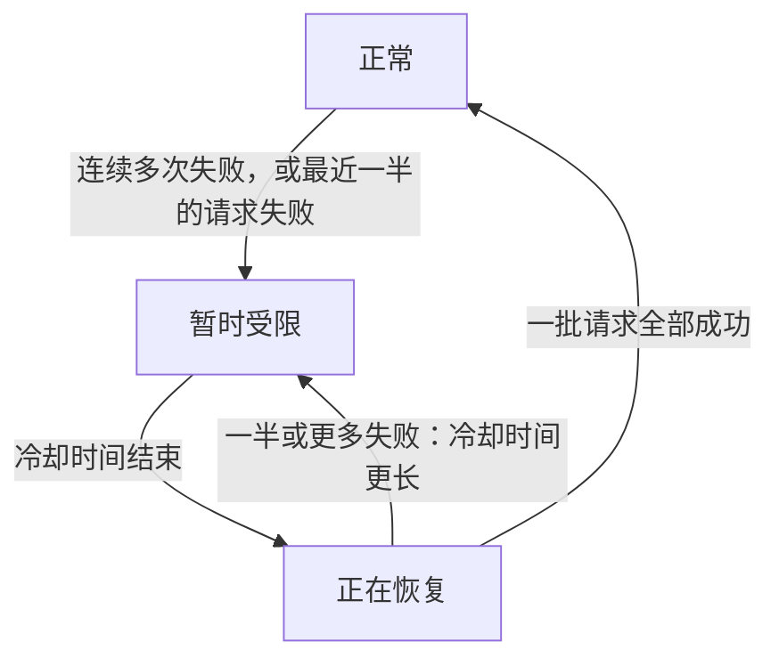

import { ProviderStatusExplorer } from "/snippets/provider-status.jsx";

在模型页面上，每个提供商名称后面最多显示两个图标：由 Phaseo 设置的**状态图标**，以及仅在 Gateway 将流量从出错的提供商转走时才显示的**实时路由图标**。

<ProviderStatusExplorer locale="zh-Hans" />

## 状态图标

此状态由 Phaseo 手动设置，在 Phaseo 更改之前会一直保留。优先级较低的路由是最后的备选：Gateway 只会在所有其他健康的提供商之后才尝试它。

| 图标 | 状态 | 路由 |
| --- | --- | --- |
| <Icon icon="circle-check" color="#16a34a" /> | `Active` | 正常路由。 |
| <Icon icon="triangle-alert" color="#d97706" /> | `优先级较低` | 仅作为备用，排在所有其他健康的提供商之后。 |
| <Icon icon="ban" color="#dc2626" /> | `Disabled` | 不会路由。 |

## 实时路由

Gateway 会根据当前处理的请求，为每个提供商、模型和端点自动设置它。受限或正在恢复的路由仍可路由，但会先尝试其他提供商。

## 可用性与集成

状态悬停卡片还会显示提供商是否提供该模型，以及 Phaseo 是否已启用它。只有两者都满足时，路由才会公开。例如，提供商可能已经提供新模型（`Available`），而 Phaseo 仍在开发支持（`Implementing`）。

### 提供商可用性

| 状态 | 含义 |
| --- | --- |
| `Available` | 提供商当前接受对此服务的请求。 |
| `Preview` | 提供商以预览形式开放此服务。 |
| `Limited Access` | 服务已存在，但访问受账户、区域、允许列表或容量限制。 |
| `Coming Soon` | 提供商已宣布或列出此服务，但目前尚不可用。 |
| `Deprecated` | 服务仍可使用，但提供商建议迁移。 |
| `Removed` | 提供商已停止提供此服务。 |
| `Unknown` | Phaseo 尚未验证上游可用性。 |

### Phaseo 集成

| 状态 | 含义 | Phaseo 路由 |
| --- | --- | --- |
| `Unsupported` | Phaseo 没有与此服务兼容的集成。 | 不可路由。 |
| `Planned` | 集成工作已获批准，但尚未开始。 | 不可路由。 |
| `Implementing` | 集成工作正在进行。 | 不可路由。 |
| `Testing` | 已实现，正在进行契约、预发布或金丝雀测试。 | 不可公开路由。 |
| `Enabled` | 已支持并启用，可用于生产环境。 | 满足路由开关和健康条件时可路由。 |
| `Disabled` | Phaseo 已主动关闭此集成。 | 不可路由。 |
| `Blocked` | 外部或未解决的依赖项阻止了发布。 | 不可路由。 |

只有 `Enabled` 的路由才能公开。`Internal` 路由只服务于 Phaseo 自己的测试流量。

## 兼容性

`availability_status`、`routing_status`、`is_active_gateway` 和 `routable` 仍保留在 API 中，供现有集成使用。新的集成应读取提供商和 Phaseo 的独立字段。

## 相关页面

- [路由和回退](./routing-and-fallbacks.mdx)
- [服务层级](./service-tiers.mdx)
- [Models API 参考](../api-reference/endpoint/models.mdx)
