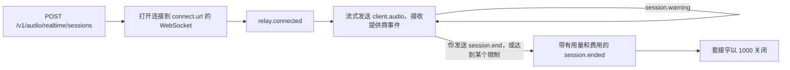

在你的服务器上创建会话，让客户端通过 WebSocket 连接到 Phaseo 中继，然后把麦克风音频流式传输到提供商的实时模型。中继会原样转发提供商自己的事件，在通话过程中进行计量，并添加三个自己的事件：通话进行中的 `session.warning`、用于挂断的 `session.end`，以及带有最终账单的 `session.ended`。

<Note>
实时语音目前处于 Beta 阶段，按工作区开放访问。
</Note>



## 开始会话

在你的服务器上创建会话：

```bash
curl https://api.phaseo.app/v1/audio/realtime/sessions \
  -H "Authorization: Bearer $PHASEO_API_KEY" \
  -H "Content-Type: application/json" \
  -d '{"model": "openai/gpt-realtime-2", "voice": "marin"}'
```

响应包含 `client_secret`、`connect.url`、`max_duration_seconds` 和 `idle_timeout_seconds`（对于 API 会话始终为 `null`）。

在 `api.phaseo.app` 上打开连接到 `connect.url` 的 WebSocket，并提供两个子协议：`statsync-realtime` 和 `rtsec.<client_secret>`。中继会选择 `statsync-realtime`。如果你只提供 `rtsec.<client_secret>`，浏览器和大多数 WebSocket 库会因为没有选中任何协议而握手失败。

提供商就绪后，中继会发送 `relay.connected`。之后按提供商的采样率，以 `{"type": "client.audio", "audio": "<base64 PCM16>"}` 的形式发送麦克风音频：

| 提供商 | 输入音频 |
| --- | --- |
| OpenAI、xAI、ElevenLabs Realtime、GPT Live | 24 kHz PCM16 |
| Google、Mistral、ElevenLabs Scribe v3 Live | 16 kHz PCM16 |

会话开始时，Phaseo 会预留 $5 的额度，并在通话进行中延长这笔预留。

[TypeScript 和 Python SDK](/zh-Hans/v1/sdk-reference/client/audio-realtime) 会替你完成以上所有步骤：`client.realtime.connect()` 创建会话并打开套接字，`session.end()` 返回 `session.ended`。其他 SDK 也有同样的小型客户端；每个包的 README 中都有示例。

| SDK | 连接 | WebSocket 库 |
| --- | --- | --- |
| Go | `realtime.Connect(ctx, client, realtime.Options{...})` | `github.com/coder/websocket`，位于单独的 `realtime` 包中 |
| Java | `client.realtime.connect(Map.of("model", ...))` | JDK `java.net.http.WebSocket` |
| C# | `await client.Realtime.ConnectAsync(new RealtimeConnectOptions { ... })` | `System.Net.WebSockets.ClientWebSocket` |
| PHP | `$client->realtime()->connect(["model" => ...])` | `phrity/websocket`（可选，`composer require phrity/websocket`） |
| Ruby | `client.realtime.connect(model: ...)` | `websocket` gem（可选） |
| Rust | `client.realtime().connect(RealtimeOptions::new(...))` | `tungstenite`，需启用 `realtime` feature |

C++ SDK 没有实时客户端。

### Google Live 连接

在整个通话期间持续流式发送麦克风音频，包括静音。如果连接大约 150 秒没有收到音频，Google 会关闭它（关闭代码 `1008`），通话随后以 `provider_closed` 结束。连续 2 分钟没有音频后，中继会发送一个带有 `threshold: "input_idle"` 的 `provider_closing` 警告。轮次之间的静音不属于任何轮次，因此不计费。

Google 还会在大约 10 分钟后替换每个连接。中继会利用 Google 的会话恢复把通话迁移到新连接上，保持你的套接字打开，并在切换完成后发送 `{"type": "relay.provider_reconnected", "reconnects": 1}`。切换期间（通常不到一秒）你发送的音频会被暂存并继续转发。恢复后的连接会重新处理到目前为止的对话，Google 会在下一轮把这部分再次按输入 token 计费，因此每次切换后，长通话的每轮费用会略高一些。所有这些都包含在 `usage` 和账单中。只有在无法恢复时，中继才会发出 `provider_closing` 警告，通话随后在 Google 关闭连接时结束。

### GPT Live 会话

GPT Live（`openai/gpt-live-1`）负责语音，并把推理交给一个 Responses 后端模型。使用 `POST /v1/live/sessions` 创建它：

```bash
curl https://api.phaseo.app/v1/live/sessions \
  -H "Authorization: Bearer $PHASEO_API_KEY" \
  -H "Content-Type: application/json" \
  -d '{
    "model": "openai/gpt-live-1",
    "provider": "openai",
    "voice": "marin",
    "backend_model": "openai/gpt-5.6-luna",
    "backend_settings": {
      "tools": [{ "type": "function", "name": "get_time", "description": "Returns the current UTC time.", "parameters": { "type": "object", "properties": {} } }]
    }
  }'
```

`voice` 为 `alloy`、`ash`、`ballad`、`beacon`、`bossa`、`cedar`、`cinder`、`coral`、`delta`、`echo`、`gleam`、`marin`、`meridian`、`quartz`、`ripple`、`sage`、`shimmer`、`stone`、`tempo`、`verse`、`vesper` 或 `willow` 之一。`backend_model` 为 `openai/gpt-5.6-luna`（默认）或 `openai/gpt-5.6-terra`。连接方式和流式发送 24 kHz 音频的方式与其他会话相同。

函数工具在你的客户端上运行。后端的调用以 `response.event` 的形式到达，其 `event.item.type` 为 `function_call`。它的名称和 `arguments` 来自模型，而通话方说的话可以影响它们，因此要把它们视为不可信的输入：

1. 只运行你声明过的工具，按 `name` 查找，拒绝任何其他名称。
2. 把 `arguments` 解析为 JSON，并在使用前根据该工具的 `parameters` schema 进行验证。
3. 检查已登录的用户是否有权执行该调用所请求的操作；在任何会更改数据、花钱或联系他人的操作之前，先征得用户确认。

然后运行工具，发送结果，并请求后续回复。如果某个调用未通过这些检查，就不要运行它，而是发送一个说明原因的 `output`：

```json
{ "type": "response.item.create", "item": { "type": "function_call_output", "call_id": "call_63hZ...", "output": "{\"utc\":\"2026-10-22T09:42:48Z\"}" } }
{ "type": "response.create" }
```

中继只接受针对后端发起的调用的 `function_call_output`，每个调用一次，最大 64 KB；并且只有在至少有一个输出之后才接受 `response.create`。其他任何内容都会收到 `{"type": "relay.client_event_rejected", "reason": "..."}`，通话继续进行。Phaseo 自己从不运行函数工具。

GPT Live 通话按语音秒数计费（每分钟 $0.05，依据 GPT Live 自己的 `usage.seconds`），另加每个响应（包括工具结果之后的回复）所用的后端模型 token。如果会话大约 30 秒没有收到音频，GPT Live 会使其过期，通话以 `provider_idle_timeout` 结束。请持续流式发送麦克风音频，包括静音。

### ElevenLabs Realtime 会话

ElevenLabs Realtime 有两个模型：`eleven-labs/eleven-realtime-v1-mini` 更快、更便宜，是默认选择；`eleven-labs/eleven-realtime-v1-max` 会先推理再回答，适合复杂指令和多步工具调用。两者都使用与 OpenAI 相同的创建请求和中继，音频为 24 kHz。Phaseo 使用自己的密钥连接 ElevenLabs；你的客户端只会看到中继。

ElevenLabs 按通话连接的每一秒计费，另加它使用的语言模型 token，并且不会在通话期间报告用量。中继会在通话进行中计量连接时长，因此预留和透支上限的工作方式与其他提供商相同。通话结束时，Phaseo 会读取 ElevenLabs 对该对话的账单，并按该账单与 Phaseo 自己按标价计算的总额中较大的一个收费。这通常需要几秒钟。如果耗时更长，`session.ended` 会带着 `billing_status: "pending"` 和一个 `final_bill` 请求到达，账单会在 ElevenLabs 报告后立即结算，通常在几分钟内。在此之前，你的预留会一直保留。如果 24 小时后 ElevenLabs 仍未报告账单，该会话会转入计费审核，而不是只按连接时长收费。

### 流式转录

流式转录模型会在音频到达时实时转录：Mistral 的 `mistral/voxtral-mini-transcribe-realtime-3` 和 `mistral/voxtral-mini-transcribe-realtime`，以及 ElevenLabs 的 `eleven-labs/scribe-v3-live`。它们不会语音回复，因此创建会话时不要带 `voice` 或 `instructions`：

```bash
curl https://api.phaseo.app/v1/audio/realtime/sessions \
  -H "Authorization: Bearer $PHASEO_API_KEY" \
  -H "Content-Type: application/json" \
  -d '{"model": "mistral/voxtral-mini-transcribe-realtime-3"}'
```

以同样方式连接，并以 `client.audio` 流式发送 16 kHz PCM16。Mistral 的事件会原样转发：先是 `session.created`，然后是带有每段新文本的 `transcription.text.delta`，以及 Mistral 发送的 `transcription.language` 和 `transcription.segment`。要更改转录设置，请发送 `{"type": "session.update", "session": {...}}`，其中可包含 `language`、`target_streaming_delay_ms`（80 到 1,200，或 2,400）、`context_bias`、`diarize` 和 `turn_detection` 中的任意项。其他字段（包括音频格式）会被拒绝，返回 `relay.client_event_rejected`。音频开始后设置即固定，因此要在第一个 `client.audio` 之前发送 `session.update`；之后的更新也会以同样方式被拒绝。较早的 `mistral/voxtral-mini-transcribe-realtime` 只接受 `target_streaming_delay_ms`。

当你发送 `session.end` 时，中继会结束 Mistral 的音频流，并最多等待 10 秒以接收携带完整转录文本的 `transcription.done`，然后再结算并发送 `session.ended`。你已经发送的音频都会被使用，不会丢弃任何内容。

对于 `eleven-labs/scribe-v3-live`，中继会把 ElevenLabs 的事件转换为同样的 `transcription.*` 事件：先是 `session.created`，然后是带有当前片段文本的 `transcription.partial`（每个都会替换上一个，并带有 `turn_probability`），每个片段完成时还有带其文本的 `transcription.text.delta` 和带其 `segment_index` 的 `transcription.segment`。启用 `include_timestamps` 或 `include_language_detection` 时，随后会收到带单词时间和检测到的语言的 `transcription.segment.words`，语言变化时还会收到 `transcription.language`。启用 `diarize` 时，随后会收到带说话人标签的 `transcription.segment.speakers`，当两个说话人 ID 被确认为同一个人时会收到 `transcription.speakers_merged`。ElevenLabs 的错误以 `error` 形式送达。

中继会在你发送第一个 `client.audio` 时连接 ElevenLabs，此后设置即固定。请在此之前发送 `session.update`，可包含以下任意字段：`language`, `secondary_languages`, `commit_strategy` (`vad`, 默认, `turn_prediction` 或 `manual`), `vad_silence_threshold_secs` (0.192 到 3), `vad_threshold`, `min_speech_duration_ms`, `min_silence_duration_ms`, `include_timestamps`, `include_language_detection`, `multilang_mode`, `diarize`, `no_verbatim`, `filter_background_audio` 和 `previous_text`；中继会以 `session.updated` 回复。关键词（keyterms）、关键词库、转录编辑以及实体检测或脱敏在 ElevenLabs 需要额外付费，目前尚不可用：它们会被 `relay.client_event_rejected` 拒绝，并带有 `reason: "realtime_transcription_option_not_supported"`。使用 `manual` 时，在发送了至少 0.3 秒新音频后发送 `{"type": "input_audio.commit"}` 来结束一个片段。请持续发送音频，包括静音：ElevenLabs 会结束 15 秒内没有收到任何内容的会话。

当你向 Scribe 会话发送 `session.end` 时，中继会提交尚未转录的音频，并最多等待 10 秒以获取其转录，然后发送带有完整转录文本的 `transcription.done` 并结算。最后一个片段之后不足 0.3 秒的音频无法提交，因此不会被转录。

流式转录按你发送的音频分钟数计费（Voxtral Mini Transcribe Realtime 3 为每分钟 $0.008，Scribe v3 Live 为每小时 $0.22），由中继计量。`transcription.done` 中 Mistral 自己的计数是最低收费；ElevenLabs 不报告用量，因此 Scribe 会话仅按中继的计数计费。对于已有的录音，请改用[音频转录](/zh-Hans/v1/api-reference/endpoint/audio-transcriptions)。

## 结束会话

当通话方挂断时，发送 `session.end`：

```json
{ "type": "session.end", "reason": "caller hung up" }
```

| 字段 | 类型 | 默认值 | 含义 |
| --- | --- | --- | --- |
| `reason` | string | 无 | 你自己的备注，最多 120 个可打印字符，会作为 `client_reason` 回显。 |
| `cancel_response` | boolean | `true` | `true` 取消仍在播放的回复。`false` 让它播放完，最多 20 秒。 |

之后中继会：

1. 停止接收音频；
2. 丢弃提供商尚未提交到某一轮次的麦克风音频；
3. 取消正在进行的回复或让它播放完，并最多等待 10 秒以获取其用量；
4. 对于 GPT Live，向提供商发送 `session.close` 并等待 `session.closed`；
5. 结算账单；
6. 发送 `session.ended`；
7. 以代码 `1000` 关闭套接字。

不发送 `session.end` 直接关闭套接字也会结束通话，并以同样方式计费，但你的客户端不会收到 `session.ended`。

## 读取最终账单：`session.ended`

每次结束时中继都会发送 `session.ended`：无论是你请求的、提供商发起的，还是 Gateway 发起的。它会在你的套接字仍然打开时发送，就在中继关闭套接字之前。

```json
{
  "type": "session.ended",
  "session_id": "rt_01k8...",
  "reason": "client_requested",
  "initiated_by": "client",
  "client_reason": "caller hung up",
  "duration_seconds": 184.2,
  "usage": { "input_audio_tokens": 1840, "output_audio_tokens": 3120, "input_text_tokens": 412 },
  "cost": {
    "total_usd": 0.231,
    "total_nanos": 231000000,
    "estimated": false,
    "estimate_basis": null,
    "debt_nanos": 0,
    "uncollected_nanos": 0,
    "currency": "USD"
  },
  "billing_status": "settled"
}
```

| 字段 | 含义 |
| --- | --- |
| `reason` | 稳定的原因代码。参见[原因代码](#reason-codes)。 |
| `initiated_by` | `client`、`gateway` 或 `provider`。 |
| `duration_seconds` | 自中继连接以来的时长。 |
| `usage` | 通话计费所依据的用量：按模态划分的 token 数，包括缓存读取和写入；`audio_seconds`，即通话的音频时长，xAI、ElevenLabs、Mistral 以及 GPT Live 的语音按此计费（在按 token 计费的通话中仅供参考）；以及 GPT Live 网页搜索的 `native_web_search_requests`。当 `billing_status` 为 `pending` 或 `unresolved` 时，这是目前已知的用量，最终计量可通过 `final_bill` 获取。 |
| `cost.estimated` | 当某个被中断轮次的提供商用量始终没有到达、部分用量根据计量的音频估算时，为 `true`。`estimate_basis` 说明原因。 |
| `cost.debt_nanos` | 超出你的预留和可用余额、以透支方式收取的那部分费用。 |
| `cost.uncollected_nanos` | 超出透支上限、未收取的费用。 |
| `provider_close_code` | 当提供商结束通话时，提供商的 WebSocket 关闭代码。 |
| `billing_status` | `settled`、`pending` 或 `unresolved`。 |

如果结算仍在重试，`billing_status` 为 `pending`，`cost` 显示当前的估算值。如果会话需要计费审核，则为 `unresolved`。这两种情况下，`final_bill` 都会给出结算后获取最终费用的请求：

```json
"final_bill": { "method": "GET", "path": "/v1/generations?id=realtime%3Art_01k8..." }
```

<span id="reason-codes"></span>
### 原因代码

| `reason` | `initiated_by` | 何时出现 |
| --- | --- | --- |
| `client_requested` | client | 你发送了 `session.end`。 |
| `client_disconnected` | client | 你的套接字在没有 `session.end` 的情况下关闭。 |
| `provider_closed` | provider | 提供商关闭了连接，例如 Google 在大约 150 秒没有音频后关闭（代码 `1008`），或在中继无法恢复的 `goAway` 之后关闭。 |
| `provider_idle_timeout` | provider | GPT Live 因大约 30 秒没有收到音频而使会话过期。 |
| `provider_error` | provider | 提供商连接失败或报告了错误。 |
| `max_duration_reached` | gateway | 达到了提供商的会话时长限制。 |
| `insufficient_funds` | gateway | 达到了透支上限。 |
| `key_revoked` | gateway | API 密钥在通话期间被撤销或删除。 |
| `key_expired` | gateway | API 密钥在通话期间过期。 |
| `key_blocked` | gateway | API 密钥在通话期间被暂停。 |
| `workspace_disabled` | gateway | 工作区已不存在。 |
| `policy_blocked` | gateway | 工作区策略变更拦截了该模型，或把提供商从允许列表中移除，并且在 `policy_blocked` 警告后 30 秒仍然有效。 |
| `input_rejected` | gateway | 中继拒绝了客户端音频：过大、快于实时速度，或提供商处理跟不上。 |
| `session_reconciled` | gateway | 中继丢失了状态，会话被对账流程关闭。 |
| `gateway_error` | gateway | Phaseo 无法处理提供商事件或记录用量。 |
| `idle_timeout` | gateway | 仅限 Playground：五分钟没有音频。 |
| `spend_limit_reached` | gateway | 仅限 Playground：达到了密钥支出限额或工作区预算。 |

之后可能会新增代码，因此请把未知的 `reason` 当作 `gateway_error` 处理。

## 处理警告：`session.warning`

警告会告诉你即将发生什么，但不会结束通话。每个代码在每个阈值最多发送一次。

```json
{ "type": "session.warning", "code": "max_duration_approaching", "message": "...", "seconds_remaining": 120, "expires_at": "2026-10-22T11:00:00.000Z" }
```

| `code` | 额外字段 | 何时出现 |
| --- | --- | --- |
| `max_duration_approaching` | `seconds_remaining`、`expires_at` | 在提供商会话时长限制前 2 分钟，以及前 30 秒再次发送。 |
| `provider_closing` | `seconds_remaining`，空闲情况下还有 `threshold: "input_idle"` | Google 即将关闭连接：在中继无法恢复的 `goAway` 之后，或（`input_idle`）因为已经 2 分钟没有收到音频。 |
| `funds_low` | `remaining_usd` | 无法延长额度预留。通话继续使用你的可用余额。 |
| `overdraft_in_use` | `remaining_usd`、`overdraft_used_usd` | 你的可用余额已用完，通话正在透支运行。当透支上限剩余不足 $0.25 时会再次发送。 |
| `spend_limit_exceeded` | `limit`（`key` 或 `workspace_budget`） | 达到了密钥支出限额或工作区预算。通话继续；新请求会被拒绝。 |
| `policy_blocked` | `status`；当 `status` 为 `ending` 时还有 `seconds_remaining` 和 `ends_at` | 工作区策略现在拦截了该通话，或其提供商已从允许列表中移除。除非撤销该变更，否则通话会在 30 秒后结束；如果撤销了，会收到第二个警告，其中 `status: "cleared"`。 |

`remaining_usd` 是通话在结束前还能花费的金额，包括透支部分。

## 通话何时会自行结束

Phaseo 从不因空闲而结束 API 会话，支出限额也只会发出警告。只有发生以下情况之一时，通话才会自行结束：

| 限制 | 值 |
| --- | --- |
| OpenAI Realtime | 60 分钟 |
| xAI | 120 分钟 |
| Google Live | 60 分钟，跨中继恢复的各个连接累计。如果你的客户端大约 150 秒停止发送音频，通话也会结束。 |
| GPT Live | 25 分钟 |
| ElevenLabs Realtime | 30 分钟 |
| Mistral 和 ElevenLabs 流式转录 | 60 分钟 |
| 透支上限 | 超出你的预留和可用余额 $1 |
| 失去访问权限 | 密钥被撤销、过期或暂停，或工作区被删除。大约一分钟内检测到，然后通话立即结束，没有宽限期。 |
| 策略变更 | 在 `policy_blocked` 警告后 30 秒，如果该策略仍然拦截通话 |

会话时长限制从中继连接时开始计算，而不是从会话创建时开始。
