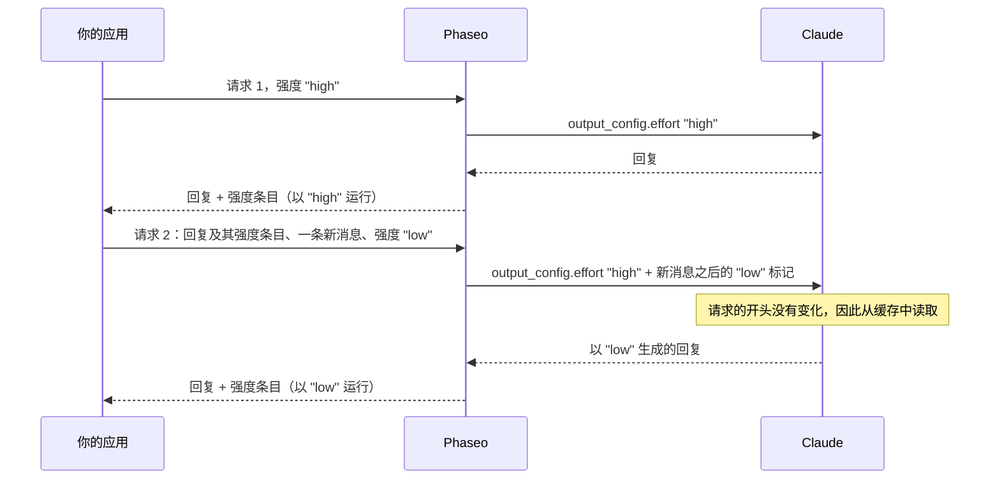

import { EffortCacheExplorer } from "/snippets/effort-cache.jsx";

在任意请求中发送不同的 `reasoning_effort`（Chat Completions）或 `reasoning.effort`（Responses），Phaseo 就会在不重启 Claude 提示词缓存的情况下更改其强度。只要你在每个请求中原样发回 Claude 的推理内容，代码的其他部分就无需改动。

<EffortCacheExplorer locale="zh-Hans" />

Phaseo 会继续向 Claude 发送对话第一个请求的强度，并把每次更改作为强度标记添加到你的新消息之后。标记之前的所有内容保持不变，因此 Claude 会从缓存中读取。如果你丢弃了推理内容，Phaseo 就会改为更改顶层强度，Claude 会重新处理从其第一条回复开始的所有内容，而不是从缓存中读取。

## Phaseo 如何保住缓存

只有当请求的开头逐字节相同时，Claude 才会读取已缓存的对话，而顶层强度就是这个开头的一部分。Anthropic 的[逐消息强度](https://platform.claude.com/docs/en/build-with-claude/effort-per-message)改为在 `messages` 内部更改级别，方法是使用一条 `content` 为空并带有 `output_config.effort` 的 `system` 消息。Phaseo 会替你写入这些标记：



Phaseo 在请求之间不存储任何内容。Claude 的每条回复都以一个推理条目结尾，记录该回复运行时的级别，Phaseo 会根据你发回的条目，在相同位置重建之前的每一个标记：

| 请求 | 你发送的值 | Phaseo 发送给 Claude 的内容 |
| --- | --- | --- |
| 1 | `"high"` | `output_config.effort: "high"` |
| 2 | `"low"` | `"high"`，外加你的新消息之后的一个 `low` 标记 |
| 3 | `"low"` | `"high"`，外加同一位置的同一个标记 |
| 4 | `"high"` | `"high"`、之前的标记，以及你的新消息之后的一个 `high` 标记 |

你发回的消息永远不会被更改。这些标记只存在于 Phaseo 发送给 Claude 的请求中。

## 原样发回推理内容

<Warning>
在每个请求中，按收到时的原样发回每一个推理条目：Chat 的 `reasoning_details`、Responses 的 `reasoning` 项以及 Anthropic 的 `thinking` 块，无论是否加密。不要丢弃、编辑、重新排序或总结它们。缺少它们时，强度更改会重启 Claude 的缓存，并且 Claude 会在工具循环的步骤之间丢失推理。
</Warning>

强度条目没有文本。在 Chat Completions 上，它是 `reasoning_details` 中的最后一个 `reasoning.encrypted` 条目：

```json
{
  "role": "assistant",
  "content": "1. Export the data. 2. Create the schema. 3. Import and verify.",
  "reasoning_details": [
    { "type": "reasoning.text", "text": "…", "signature": "phx1.…", "format": "anthropic-claude-v1" },
    { "type": "reasoning.encrypted", "data": "phx1.…", "format": "anthropic-claude-v1" }
  ]
}
```

在 Responses 上，它是 `output` 中的最后一个 `reasoning` 项，其 `id` 以 `rs_effort_` 开头：

```json
{ "type": "reasoning", "id": "rs_effort_req_123", "summary": [], "content": [], "encrypted_content": "phx1.…" }
```

该值是不透明的，Phaseo 会在对话到达任何提供商之前将其移除。

## 在代码中更改强度

把 Claude 的整条回复追加到你的对话中，然后在下一个请求中设置你想要的强度。顶层的 `cache_control` 会为 Claude 路由开启缓存；参见[提示词缓存](./prompt-caching.mdx#which-providers-cache-automatically)。

### Chat Completions

<CodeGroup>
```ts TypeScript
import OpenAI from "openai";

const client = new OpenAI({
	apiKey: process.env.PHASEO_API_KEY,
	baseURL: "https://api.phaseo.app/v1",
});

const messages: OpenAI.ChatCompletionMessageParam[] = [
	{ role: "user", content: "Plan a migration from SQLite to PostgreSQL." },
];

async function ask(effort: "low" | "medium" | "high") {
	const response = await client.chat.completions.create({
		model: "anthropic/claude-opus-5.5",
		reasoning_effort: effort,
		messages,
		// @ts-expect-error Phaseo field: cache the conversation on Claude routes
		cache_control: { type: "ephemeral" },
	});
	const message = response.choices[0].message;
	messages.push(message); // the whole message, reasoning_details included
	return message.content;
}

await ask("high");
messages.push({ role: "user", content: "Summarise the plan in one sentence." });
await ask("low"); // Claude reads request 1 from cache
```

```python Python
import os
from openai import OpenAI

client = OpenAI(
    api_key=os.environ["PHASEO_API_KEY"],
    base_url="https://api.phaseo.app/v1",
)

messages = [{"role": "user", "content": "Plan a migration from SQLite to PostgreSQL."}]

def ask(effort: str) -> str | None:
    response = client.chat.completions.create(
        model="anthropic/claude-opus-5.5",
        reasoning_effort=effort,
        messages=messages,
        extra_body={"cache_control": {"type": "ephemeral"}},
    )
    message = response.choices[0].message
    # The whole message, reasoning_details included
    messages.append(message.model_dump(exclude_none=True))
    return message.content

ask("high")
messages.append({"role": "user", "content": "Summarise the plan in one sentence."})
ask("low")  # Claude reads request 1 from cache
```
</CodeGroup>

### Responses

Phaseo 不存储响应，因此请在 `input` 中发送完整对话，包括每一个 `output` 项。

<CodeGroup>
```ts TypeScript
import OpenAI from "openai";

const client = new OpenAI({
	apiKey: process.env.PHASEO_API_KEY,
	baseURL: "https://api.phaseo.app/v1",
});

const input: OpenAI.Responses.ResponseInput = [
	{ role: "user", content: "Plan a migration from SQLite to PostgreSQL." },
];

async function ask(effort: "low" | "medium" | "high") {
	const response = await client.responses.create({
		model: "anthropic/claude-opus-5.5",
		reasoning: { effort },
		input,
		// @ts-expect-error Phaseo field: cache the conversation on Claude routes
		cache_control: { type: "ephemeral" },
	});
	input.push(...response.output); // every item, reasoning items included
	return response.output_text;
}

await ask("high");
input.push({ role: "user", content: "Summarise the plan in one sentence." });
await ask("low"); // Claude reads request 1 from cache
```

```python Python
import os
from openai import OpenAI

client = OpenAI(
    api_key=os.environ["PHASEO_API_KEY"],
    base_url="https://api.phaseo.app/v1",
)

conversation = [{"role": "user", "content": "Plan a migration from SQLite to PostgreSQL."}]

def ask(effort: str) -> str:
    response = client.responses.create(
        model="anthropic/claude-opus-5.5",
        reasoning={"effort": effort},
        input=conversation,
        extra_body={"cache_control": {"type": "ephemeral"}},
    )
    # Every item, reasoning items included
    conversation.extend(item.model_dump(exclude_none=True) for item in response.output)
    return response.output_text

ask("high")
conversation.append({"role": "user", "content": "Summarise the plan in one sentence."})
ask("low")  # Claude reads request 1 from cache
```
</CodeGroup>

### Anthropic Messages

在 `/v1/messages` 上，你需要自己发送标记：一条 `content` 为空并带有 `output_config.effort` 的 `system` 消息。在每个请求中保持顶层的 `output_config.effort` 不变，并在后续请求中让每个标记保持在原位。Phaseo 会添加 `mid-conversation-output-config-2026-07-01` beta 请求头，因此你无需发送它。

```bash cURL
curl https://api.phaseo.app/v1/messages \
  -H "x-api-key: $PHASEO_API_KEY" \
  -H "anthropic-version: 2023-06-01" \
  -H "Content-Type: application/json" \
  -d '{
    "model": "anthropic/claude-opus-5.5",
    "max_tokens": 4096,
    "cache_control": { "type": "ephemeral" },
    "output_config": { "effort": "high" },
    "messages": [
      { "role": "user", "content": "Plan a migration from SQLite to PostgreSQL." },
      { "role": "assistant", "content": "1. Export the data. 2. Create the schema. 3. Import and verify." },
      { "role": "system", "content": [], "output_config": { "effort": "low" } },
      { "role": "user", "content": "Summarise the plan in one sentence." }
    ]
  }'
```

标记所在的位置决定新级别何时开始生效：

- **紧跟在一条用户消息之后：** Claude 对该消息的回复使用新级别。
- **其他任何位置**，例如上例中位于 Claude 的回复和你的下一条消息之间：新级别从你的下一条消息开始生效。

只包含工具结果的用户消息不算作新消息。在不支持逐消息强度的路由上，Phaseo 会移除这些标记，并将当前生效的级别作为顶层强度发送。

## 更改何时会重启缓存

在以下情况下，Phaseo 会像对其他提供商一样更改顶层强度：

- **推理内容缺失。** 你最新的 Claude 回复没有强度条目，因为你的客户端丢弃了 `reasoning_details` 或 `reasoning` 项。
- **更改发生在工具循环的步骤之间。** 你的最新消息只包含工具结果，因此标记只能从你的下一条消息开始生效。Phaseo 会更改顶层强度，使这一步以你要求的级别运行，之后的更改会再次使用标记。
- **请求没有设置强度，或关闭了推理。** 在每个请求中发送 `reasoning_effort` 或 `reasoning.effort`。`"none"` 和 `reasoning.enabled: false` 会关闭推理。
- **路由不支持此功能。** 参见[支持的模型](#supported-models)。

顶层更改会让对话中位于 Claude 第一条回复之前的部分保留在缓存中。Claude 会重新处理从该回复开始的所有内容，并将其作为新输入计费。

<span id="supported-models"></span>
## 支持的模型

| 路由 | 模型 |
| --- | --- |
| Anthropic、Google Vertex AI | Claude Fable 5.2 和 5.1、Mythos 5.2 和 5.1、Opus 5.5 和 5、Sonnet 5.5、Haiku 5.5 |
| Claude on AWS | 除 Mythos 外的相同模型 |
| Amazon Bedrock | Claude Fable 5.1 和 Opus 5.5 |

在其他所有路由上（包括 Azure 上的 Claude），强度更改都会作为顶层强度发送。

## 检查缓存是否保住

读取更改之后那个请求的缓存计数：Chat Completions 上的 `usage.prompt_tokens_details.cached_tokens`、Responses 上的 `usage.input_tokens_details.cached_tokens`，以及 Anthropic Messages 上的 `usage.cache_read_input_tokens`。[用量与定价字段](./prompt-caching.mdx#usage-and-pricing-fields)列出了所有字段。

我们于 2026 年 11 月 11 日在 `anthropic/claude-haiku-5.5` 上对同一个包含五个请求的 Chat Completions 对话进行了测量，一次发回强度条目，一次不发回。强度依次为 `high`、`high`、`low`、`low`、`high`，并且第二条消息中带有一份 3,400 token 的文档：

| 请求 3（强度从 `high` 改为 `low`） | 丢弃强度条目 | 发回强度条目 |
| --- | --- | --- |
| 从缓存读取的 token | 0 | 3,575 |
| 重新处理并写入缓存的 token | 3,499 | 75 |
