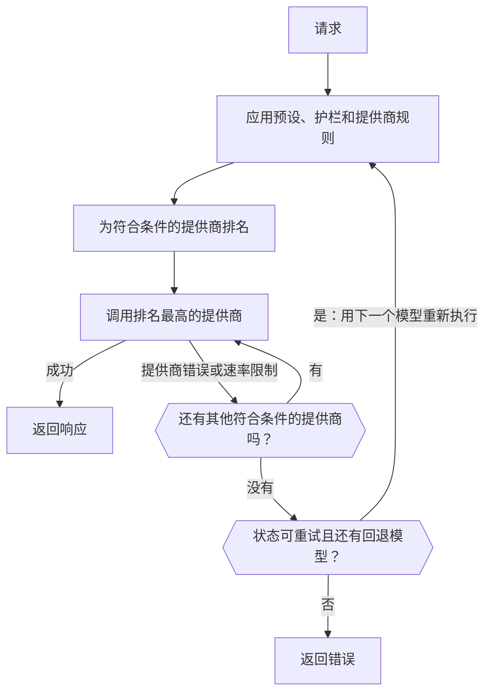

import { RoutingCostExplainer } from "/snippets/routing-cost.jsx";
import { FallbackChainExplorer } from "/snippets/fallback-chain.jsx";

大多数模型由多个提供商提供服务。对于每个请求，Gateway 会保留你的规则允许的提供商，对它们排名，然后调用最佳的那个。如果该提供商失败，就尝试下一个；如果所有提供商都以可重试的错误失败，它还可以转向回退模型。



你的客户端仍应对 `429` 和 `5xx` 响应使用指数退避进行重试。

<span id="choose-how-providers-are-ranked"></span>
## 选择提供商的排名方式

| 模式 | 排名依据 | 适用场景 |
| --- | --- | --- |
| `balanced`（默认） | 每个成功回答的成本 | 你希望在价格、速度和可靠性之间取得最佳平衡。 |
| `price` | 价格 | 成本比响应时间更重要。 |
| `latency` | 首个 token 的时间 | 响应必须快速开始。 |
| `throughput` | 输出速度 | 长输出必须快速完成。 |

在**控制台 -> 设置 -> 路由**中设置工作区默认值，或使用 `phaseo settings update --routing-mode <mode>`，或在 `PATCH /v1/settings` 上设置 `routing_mode`。对于单个请求，发送 `provider.sort` 或 `routing.mode`，或在模型 ID 后添加后缀：

| 后缀 | 模式 | 示例 |
| --- | --- | --- |
| `:nitro` | `throughput` | `openai/gpt-6-astra:nitro` |
| `:cheap` | `price` | `openai/gpt-6-astra:cheap` |
| `:fast` | `latency` | `openai/gpt-6-astra:fast` |

后缀会覆盖 `routing.mode`、`provider.sort` 以及预设和工作区的模式。允许列表、区域、护栏和价格上限仍然适用。

路由设置页面还有 Beta 和 Alpha 渠道开关，因此预览提供商只有在你选择加入时才会获得流量。

## balanced 模式如何为提供商排名

对于文本请求（Chat Completions、Responses 和 Messages），`balanced` 会估算每个提供商的**每个成功回答的成本**：

- **Token：** 该模型的典型请求在该提供商上的花费，依据该模型实测的提示词和输出大小，以及该提供商实测的缓存命中率。
- **等待：** 首个 token 的时间和完整响应的时间，按该模型每秒的典型价格换算成美元。
- **失败：** 总额除以该提供商近期的成功率，再加上对提供商错误的惩罚，以及对速率限制较小的惩罚。

成本接近最低的提供商会分得大部分流量。每个提供商都会保留一小部分流量，这样恢复情况才能被察觉。选择一个场景，看看结果如何（提供商仅为示例）：

<RoutingCostExplainer locale="zh-Hans" />

其他端点按可靠性、延迟、尾部延迟、吞吐量、价格和 token 适配度评分。如果你是提供商，[提供商如何获得流量](./how-providers-earn-traffic)介绍了如何赢得更大的份额。

<span id="request-level-model-fallbacks"></span>
## 请求级模型回退

在 `models` 中列出回退模型。Phaseo 会先尝试 `model`，然后按顺序尝试每个条目：

```json
{
  "model": "openai/gpt-6-astra",
  "models": ["anthropic/claude-sonnet-5.5", "google/gemini-4-argon"],
  "input": "Summarize this incident report."
}
```

选择每个模型的返回结果，看看 Phaseo 何时会转向下一个：

<FallbackChainExplorer locale="zh-Hans" />

**哪些情况会转到下一个模型。** 只有当前一个模型在用尽其所有提供商重试后以 `429`、`500`、`502`、`503` 或 `504` 结束时，才会尝试下一个模型。来自 Phaseo 预算或免费模型配额的 `429` 也会转向下一个，因为其他模型可能符合剩余的限额。没有任何提供商再提供的模型（例如[已退役](#retired-models)的模型）也是如此。

**哪些情况不会。** `400`、`401`、`402`、`403`、`404`、`408`、`413` 和 `422` 等客户端错误会立即返回。第一个模型运行之前的失败（例如认证失败或 API 密钥速率限制）也是如此。

**列表规则：**

- `model` 为必填项；只发送 `models` 会返回 `400`。
- `models` 接受 1 到 25 个条目。重复项以及与 `model` 相同的项会被忽略。
- 条目可以是模型 ID、[带提供商限定的 ID](./provider-qualified-models) 或 `@support` 这样的预设。
- 每次尝试都会作为独立请求进行验证（端点、参数、工作区模型、护栏、预设、价格、BYOK）。无法处理该请求的回退会被跳过并记录；它永远不会替代你本来会收到的错误。与已经进行过的尝试完全相同的尝试也会被跳过。

**日志和计费。** 每次尝试都是一个独立请求，有自己的用量记录，计费方式与没有回退时相同。响应中的 `model` 字段指明给出回答的模型，其路由跟踪会列出主请求 ID、回退顺序和之前的每次尝试。

**流式、视频和音乐。** 流只会在第一个字节之前回退；之后的错误会在流中返回。视频和音乐只会在提交任务时回退。

**与其他路由控制一起使用。** 已关联的动态路由中的回退优先于 `models`，并且路由选定的固定模型仍会应用于每次尝试。预设会对使用它的每次尝试应用自己的约束。[`phaseo/auto`](./auto-routing) 自行管理回退，不能与 `models` 组合使用。

| 端点 | `models` |
| --- | --- |
| Chat Completions、Responses、Messages | 支持，包括第一个字节之前的流 |
| Embeddings、Moderations、Rerank | 支持 |
| 图像生成和编辑 | 支持，包括 multipart 上传 |
| 语音、转录和翻译 | 支持，包括 multipart 上传 |
| OCR、Parse、Decisions | 支持 |
| 视频和音乐生成 | 在提交任务时支持 |
| Batches | `400`：每个批处理行指向一个模型 |
| 实时和 Live 会话 | `400`：一个会话绑定一个模型 |
| Council 运行 | `400`：模型来自运行配置 |

Multipart 端点接受重复的 `models` 字段、`models[]` 字段，或一个 JSON 数组字符串。另请参见[速率限制](../api-reference/limits.mdx)和[错误](../api-reference/errors.mdx)。

<span id="pin-one-provider"></span>
## 固定一个提供商

把提供商放在模型 ID 前面，即可只使用该提供商：

```json
{
  "model": "baseten:thinking-machines/inkling-small",
  "input": "Hello"
}
```

这会关闭该请求的跨提供商回退。后缀仍属于模型 ID，例如 `baseten:google/gemma-4-26b-a4b:free`。[带提供商限定的模型 ID](./provider-qualified-models) 介绍了完整的语法和错误。

## 限制使用哪些提供商

| 控制项 | 位置 | 作用 |
| --- | --- | --- |
| [预设](./presets) | **设置 -> 预设** | 允许的模型以及提供商允许或忽略列表，在排名之前应用，因此也会限制回退。 |
| [区域路由](./regional-routing) | 请求或工作区 | 把执行或数据保留在某个区域内。 |
| 动态路由 | **设置 -> 路由** | 按密钥设置的规则：见下文。 |
| BYOK 回退 | **设置 -> BYOK** | 失败的 BYOK 请求是否可以改用 Phaseo 额度重试。 |

<span id="attach-routing-rules-to-api-keys"></span>
### 为 API 密钥关联路由规则

动态路由是一组关联到一个或多个推理 API 密钥的规则流程。它可以：

- 根据请求体字段、请求头、自定义 `metadata`、端点、模型或会话 ID 进行分支
- 按百分比拆分流量，用于 A/B 测试和逐步发布
- 限制每个密钥每日、每周或每月的请求数或费用
- 切换模型、路由模式、提供商偏好和回退模型（最多八个）
- 开启缓存感知和会话感知的提供商亲和性

条件节点有 true 和 false 两个输出；速率和预算节点有未超出和已超出两个输出。百分比拆分按会话或提示词缓存键确定，因此已缓存的对话不会在分支之间移动。

保存会创建一个不可更改的草稿版本。部署会把该版本复制到 Gateway，并清除其密钥的策略缓存；之前的版本仍可用于回滚。提供商健康状况的建议显示在 **Insights** 下。在 CLI 中：`phaseo routing dynamic-routes create`、`set-keys` 和 `deploy`，或使用 `/v1/routing/dynamic-routes` API。

在 OpenAI 兼容的文本端点上，自定义元数据放在请求体中：

```json
{
  "model": "openai/gpt-6-astra",
  "metadata": { "customer_plan": "pro", "workspace": "acme" }
}
```

## 让对话保持在同一个提供商上

文本生成默认开启缓存感知路由。发送 `prompt_cache_key` 或 `session_id`，或者通过 `cache_control` 启用缓存（顶层、在 `provider_options.anthropic` 中，或作为消息块或工具上的 `cache_control` 或 `prompt_cache_breakpoint` 标记）的请求，会被固定到处理其第一个成功请求的提供商和路由。其他请求在某个提供商对相同的开头上下文报告了缓存读取或写入后，如果该提供商的缓存输入比标准输入便宜，就会被固定 15 分钟。

| | |
| --- | --- |
| 固定时长 | 15 分钟到 24 小时，取决于提供商的缓存保留时间。使用 `session_id` 时，最长为 24 小时的会话活跃期。 |
| 范围 | 按工作区。使用 `session_id` 时，以会话而不是开头上下文为键。 |
| 固定在以下情况转移 | 提供商的熔断器打开、错误率较高、Phaseo 在其上的托管配额用完，或你的规则不再允许它。 |

使用 `provider.cache_aware_routing: false` 可以为单个请求关闭此功能；或者使用 `routing.session_affinity: false` 保留缓存亲和性但忽略会话：

```json
{
  "model": "openai/gpt-6-astra",
  "session_id": "support-session-42",
  "routing": { "session_affinity": false }
}
```

[提供商亲和性](./prompt-caching.mdx#provider-affinity)列出了 Phaseo 发送给每个提供商的提示信息。

<span id="explain-a-routing-decision"></span>
## 解读路由决策

打开**控制台 -> 设置 -> 用量 -> 请求日志**，选择一个请求，然后展开 **提供商响应** 下的 **路由可观测性**。它会显示：

- 每个参与排名的提供商及其最终得分，以及哪些被选中和尝试
- 在排名之前被排除的提供商及原因
- 因发布状态或路由状态被降级的提供商
- 每个得分的输入、权重、贡献和乘数

得分因素会改变得分；记录的上下文用于解释决策，但不一定会影响它。跟踪中只包含数字和状态，从不包含提示词或输出。在启用路由可观测性之前发出的请求，可能只显示部分跟踪，或完全没有。

### 哪些情况会计入提供商的不可用时间

| 会降低可用率 | 不会 |
| --- | --- |
| `401` 认证失败 | `400` 错误请求 |
| `402` 支付失败 | `403` 地域限制 |
| `404` 模型未找到 | `413` 负载过大 |
| `500` 及以上 | `429` 速率限制 |
| 流开始后出现的错误 | |
| 以错误原因结束的 `200` | |

地域限制和速率限制会单独跟踪，因为它们并不意味着提供商宕机。在生产环境中，请记录请求 ID、状态码和模型 ID，以便把失败与这些跟踪对应起来。

<span id="retired-models"></span>
## 已退役的模型

只要还有提供商在提供已退役的模型，它就能继续使用。之后，请求会以 `410 model_retired` 失败，除非工作区通过已退役模型路由把它们发送到替代模型。你自己的 `models` 列表始终会被优先尝试。参见[模型弃用与退役](./model-retirement.mdx)。

<span id="byok-considerations"></span>
## BYOK 注意事项

使用 <Tooltip tip="自带密钥：Phaseo 使用你自己的提供商 API 密钥路由请求，模型用量由提供商直接向你计费。">BYOK</Tooltip> 时，Phaseo 负责路由和记录请求，模型用量由你的提供商计费。

| | |
| --- | --- |
| 服务费 | 每个 UTC 月份前 250,000 个已完成的 BYOK 请求免费，之后按提供商等价成本的 2.5% 收取。 |
| Phaseo 额度 | 至少保留 $1 可用额度，用于托管回退以及超出免费额度后的费用。 |
| 提供商规则 | 你的提供商的配额、数据政策、模型访问权限和账户限制仍然适用。 |
| 存储 | 密钥使用 AES-256-GCM 加密，并绑定到其工作区和提供商。 |

把每个密钥的范围限定在需要它的模型和 API 密钥上。要阻止失败的 BYOK 请求改用 Phaseo 额度重试，请在**控制台 -> 设置 -> BYOK** 中关闭回退，或在 `PATCH /v1/settings` 上设置 `byok_fallback_enabled`（`phaseo settings update --body-json '{"byok_fallback_enabled":false}'`）。使用 `phaseo byok create --provider <id> --name <name> --key-stdin` 添加密钥。
