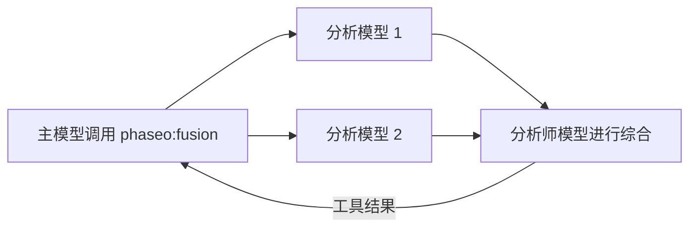

当答案需要多个独立观点时（例如规划决策、研究综述或设计评审），请添加 `phaseo:fusion`。主模型调用它时，Phaseo 会把问题并行发送给每个分析模型，再让一个分析师模型合并它们的结论，并返回这份综合结果。它会增加延迟，所以如果一轮评审就够了，请使用单个 [Advisor](./advisor)。



```json
{
  "tools": [
    {
      "type": "phaseo:fusion",
      "parameters": {
        "analysis_models": ["anthropic/claude-opus-5", "openai/gpt-5"],
        "model": "google/gemini-pro-latest",
        "instructions": "Reconcile disagreements and return concise synthesis guidance.",
        "max_uses": 1,
        "max_completion_tokens": 1400
      }
    }
  ]
}
```

在 Playground 中，服务器工具菜单可以设置同样的内容：分析模型、可选的评判（分析师）模型和调用次数上限。

## 参数

| 参数 | 类型 | 默认值 | 说明 |
| --- | --- | --- | --- |
| `analysis_models` | string[] | 必填 | 至少 2 个模型。少于 2 个会拒绝请求。 |
| `model` | string | 请求的模型 | 撰写综合结果的分析师模型。 |
| `instructions` | string | 无 | 同时用于分析调用和分析师调用的指令。 |
| `max_uses` | integer | `1` | 每个请求中的 Fusion 调用次数，最多 `4`。 |
| `max_completion_tokens` | integer | `1400` | 每次分析和综合的输出 token 数，最多 `32000`。 |

## 模型发送的内容

一个 `prompt`：需要多种视角的问题。

## 工具返回的内容

```json
{
  "status": "ok",
  "analyses": 2,
  "analysis": "Both reviewers flag the cutover order..."
}
```

`analyses` 是作出回答的分析模型数量。如果有些失败，综合结果会使用其余的分析。错误结果有 `fusion_invalid_request`（没有 prompt）、`fusion_max_uses_exceeded`、`fusion_panel_failed`（所有分析模型都失败）和 `fusion_request_failed`（分析师失败）。

## 用量和价格

每次调用会使 `usage.server_tool_use.fusion_requests` 加 1，并可按 `server_tool_fusion_requests` 计费。每次分析调用和分析师调用的 token 都会计入请求的用量，并按对应模型的价格计费。
