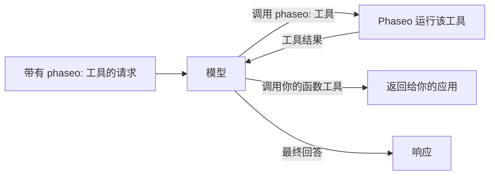

在 `tools` 中添加一个 `phaseo:` 工具，模型调用它时由 Phaseo 替你运行：模型请求当前时间、网页搜索或另一个模型的意见，Phaseo 执行调用并把结果送回，模型再完成回答。你不需要编写工具执行器。



<Note>
服务器工具处于 Beta 阶段。随着提供商支持的变化，请求结构和结果负载可能会发生变化。
</Note>

## 可用工具

| 工具 | 类型 | 用途 | 端点 |
| --- | --- | --- | --- |
| [日期时间](./datetime) | `phaseo:datetime` | 最多 5 个时区的当前日期和时间 | 全部三个 |
| [网页搜索](./web-search) | `phaseo:web_search` | 在网上搜索最新或有来源的信息 | 全部三个 |
| [Web Fetch](./web-fetch) | `phaseo:web_fetch` | 读取指定 URL 的文本 | 全部三个 |
| [Advisor](./advisor) | `phaseo:advisor` | 请另一个模型评审或制定计划 | 全部三个 |
| [Subagent](./subagent) | `phaseo:subagent` | 把一个独立任务交给工作模型 | 全部三个 |
| [Fusion](./fusion) | `phaseo:fusion` | 获取多个模型的分析，再得到一份综合结果 | 全部三个 |
| [模型搜索](./search-models) | `phaseo:search_models` | 在实时 Phaseo 模型目录中查找模型 | 全部三个 |
| [图像生成](./image-generation) | `phaseo:image_generation` | 在回答时生成图像 | 全部三个 |
| [应用补丁](./apply-patch) | `phaseo:apply_patch` | 返回经过验证的文件补丁 | 仅 `/v1/responses` |

“全部三个”指 `/v1/chat/completions`、`/v1/responses` 和 `/v1/messages`。

## 发送请求

```bash
curl https://api.phaseo.app/v1/chat/completions \
  -H "Authorization: Bearer $PHASEO_API_KEY" \
  -H "Content-Type: application/json" \
  -d '{
    "model": "openai/gpt-6-astra",
    "messages": [
      { "role": "user", "content": "What are the latest AI policy updates this week?" }
    ],
    "tools": [
      { "type": "phaseo:web_search" },
      { "type": "phaseo:datetime", "parameters": { "timezones": ["Europe/London", "UTC"] } }
    ]
  }'
```

每个工具都接受一个可选的 `parameters` 对象，详见各自的页面。`stream: true` 同样可用：Phaseo 自己运行工具轮次，并把最终回答以流式发送给你。

## 混合使用服务器工具和你自己的函数

Phaseo 只运行 `phaseo:` 工具。同一请求中的普通 `function` 工具会照常返回给你的应用，你需要在后续请求中把它的结果发回，做法与[工具调用](../tool-calling)相同。

```json
{
  "model": "openai/gpt-6-astra",
  "messages": [
    { "role": "user", "content": "Find recent funding news and save the best item." }
  ],
  "tools": [
    { "type": "phaseo:web_search", "parameters": { "max_results": 3 } },
    {
      "type": "function",
      "function": {
        "name": "save_research_item",
        "description": "Save a selected research item",
        "parameters": {
          "type": "object",
          "properties": {
            "title": { "type": "string" },
            "url": { "type": "string" }
          },
          "required": ["title", "url"]
        }
      }
    }
  ]
}
```

## 工具循环的限制

| 限制 | 值 | 达到限制时 |
| --- | --- | --- |
| 每个请求的服务器工具调用次数 | 请求中的 `max_tool_calls`，默认 `30`，最大 `100` | `400 gateway_server_tool_limit` |
| 后续轮次 | `8` | `502 gateway_server_tool_error` |
| 对单个工具的调用次数 | 该工具的 `max_uses` | 工具向模型返回错误结果，模型可以不使用该工具继续 |

## 用量和价格

每个服务器工具都会在 `usage.server_tool_use` 中增加一个计数器，模型的价格卡可以对相应的计价项计费。第二个模型（Advisor、Subagent、Fusion、图像生成）使用的 token 会计入请求的用量，并按该模型的价格计费。

```json
{
  "usage": {
    "input_tokens": 105,
    "output_tokens": 250,
    "server_tool_use": {
      "datetime_requests": 1,
      "web_search_requests": 2,
      "web_search_results": 8
    }
  }
}
```

| 工具 | 用量计数器 | 计价项 |
| --- | --- | --- |
| 日期时间 | `datetime_requests` | 无 |
| 网页搜索 | `web_search_requests`、`web_search_results`、`web_search_extra_results` | `server_tool_web_search_requests`、`server_tool_web_search_extra_results` |
| Web Fetch | `web_fetch_requests` | `server_tool_web_fetch_requests` |
| Advisor | `advisor_requests` | `server_tool_advisor_requests` |
| Subagent | `subagent_requests` | `server_tool_subagent_requests` |
| Fusion | `fusion_requests` | `server_tool_fusion_requests` |
| 模型搜索 | `search_models_requests` | `server_tool_search_models_requests` |
| 图像生成 | `image_generation_requests` | `server_tool_image_generation_requests` |
| 应用补丁 | `apply_patch_requests` | `server_tool_apply_patch_requests` |

当网页搜索或 Web Fetch 以提供商自己的工具运行时（`engine: "native"`），改为按 `native_web_search_requests` 或 `native_web_fetch_requests` 计费。
