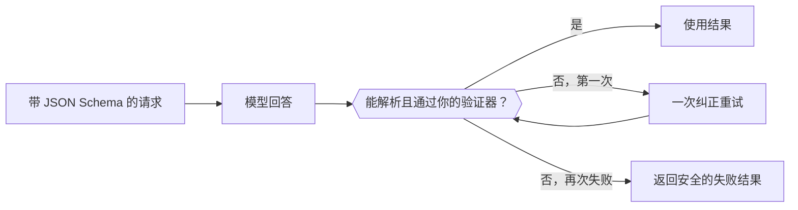

随请求发送一个 JSON Schema，模型就会返回符合该结构的 JSON，而不是自由文本。你的代码仍需在使用前解析并验证它。



## 选择格式

| `type` | 你得到的内容 |
| --- | --- |
| `json_schema` | 遵循你所发送 Schema 的 JSON。默认使用此项。 |
| `json_object` | 某个有效的 JSON 对象，不强制结构。 |
| `text` | 纯文本（默认值）。 |

格式放在哪里取决于端点：

| 端点 | 字段 |
| --- | --- |
| `/v1/chat/completions` | `response_format` |
| `/v1/responses` | `text.format` |
| `/v1/messages` | `output_config.format`（仅 `json_schema`） |

## 发送 Schema

<CodeGroup>
```bash Chat Completions
curl https://api.phaseo.app/v1/chat/completions \
  -H "Authorization: Bearer $PHASEO_API_KEY" \
  -H "Content-Type: application/json" \
  -d '{
    "model": "openai/gpt-6-astra",
    "messages": [
      { "role": "user", "content": "Return the city and weather for London." }
    ],
    "response_format": {
      "type": "json_schema",
      "json_schema": {
        "name": "weather",
        "strict": true,
        "schema": {
          "type": "object",
          "properties": {
            "city": { "type": "string" },
            "weather": { "type": "string" }
          },
          "required": ["city", "weather"],
          "additionalProperties": false
        }
      }
    }
  }'
```

```bash Responses
curl https://api.phaseo.app/v1/responses \
  -H "Authorization: Bearer $PHASEO_API_KEY" \
  -H "Content-Type: application/json" \
  -d '{
    "model": "openai/gpt-6-astra",
    "input": "Return the city and weather for London.",
    "text": {
      "format": {
        "type": "json_schema",
        "name": "weather",
        "strict": true,
        "schema": {
          "type": "object",
          "properties": {
            "city": { "type": "string" },
            "weather": { "type": "string" }
          },
          "required": ["city", "weather"],
          "additionalProperties": false
        }
      }
    }
  }'
```
</CodeGroup>

JSON 以字符串形式出现在消息内容中返回：

```json
{
  "choices": [
    {
      "finish_reason": "stop",
      "message": {
        "role": "assistant",
        "content": "{\"city\":\"London\",\"weather\":\"Cloudy\"}"
      }
    }
  ]
}
```

## 设计 Schema

从一个小对象开始。把每个字段都列入 `required`，对已知类别使用 `enum`，需要拒绝额外键时设置 `additionalProperties: false`。让 Schema 与服务器端验证器一起进行版本管理，使两者始终保持一致。

<span id="validate-the-result"></span>
## 验证结果

解析之前，先检查是否有拒绝、内容缺失或回答被截断（`finish_reason` 不是 `stop`）。然后验证解析出的对象。下面的 Zod 验证器与上面的 Schema 一致：

```typescript
import { z } from "zod";

const Weather = z.object({
  city: z.string(),
  weather: z.string(),
}).strict();

function parseWeather(content: string) {
  return Weather.parse(JSON.parse(content));
}
```

如果验证失败，把错误放进提示词重试一次，然后返回安全的失败结果。每次重试都会计费。有效的 JSON 也不能证明值是正确的，或某个操作已获授权。

按模型和 Schema 版本跟踪验证失败，并在其中任何一项变化时重新运行你的评估用例。要自动修复格式错误的 JSON，请参阅[响应修复](../cookbook/response-healing-for-structured-json.mdx)。
