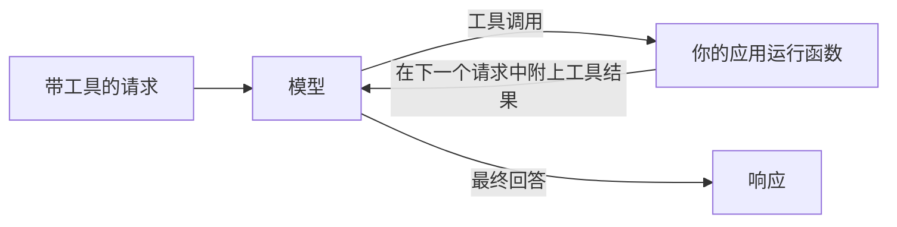

在 `tools` 中描述你的函数，模型就会以调用其中某个函数（例如查询数据库或检查天气）来回答，而不是猜测。你的应用运行该函数并把结果发回；然后模型写出最终回答。



三个文本端点都支持工具调用，各自使用自己的格式：

| 端点 | 模型的调用 | 你的结果 |
| --- | --- | --- |
| `/v1/chat/completions` | 助手消息上的 `tool_calls`，`finish_reason: "tool_calls"` | 一条 `role: "tool"` 消息 |
| `/v1/responses` | 一个 `function_call` 输出项 | 一个 `function_call_output` 输入项 |
| `/v1/messages` | 一个 `tool_use` 内容块 | 一个 `tool_result` 内容块 |

## 发送带工具的请求

```bash
curl https://api.phaseo.app/v1/chat/completions \
  -H "Authorization: Bearer $PHASEO_API_KEY" \
  -H "Content-Type: application/json" \
  -d '{
    "model": "openai/gpt-6-astra",
    "messages": [
      { "role": "user", "content": "What is the weather in London?" }
    ],
    "tools": [
      {
        "type": "function",
        "function": {
          "name": "get_weather",
          "description": "Get current weather by city",
          "parameters": {
            "type": "object",
            "properties": {
              "city": { "type": "string" }
            },
            "required": ["city"]
          }
        }
      }
    ],
    "tool_choice": {
      "type": "function",
      "function": { "name": "get_weather" }
    }
  }'
```

这里的 `tool_choice` 强制模型调用该工具。省略它，或设为 `"auto"`，就由模型决定。

模型会以调用而不是文本来回复：

```json
{
  "id": "chatcmpl_...",
  "object": "chat.completion",
  "choices": [
    {
      "index": 0,
      "finish_reason": "tool_calls",
      "message": {
        "role": "assistant",
        "content": null,
        "tool_calls": [
          {
            "id": "call_123",
            "type": "function",
            "function": {
              "name": "get_weather",
              "arguments": "{\"city\":\"London\"}"
            }
          }
        ]
      }
    }
  ]
}
```

在运行任何东西之前，先解析并检查 `arguments`；请参阅[工具调用安全](./tool-calling-safety)。然后在下一个请求中把助手消息和你的结果发回。[工具调用模式](./tool-calling-patterns)展示了 Chat Completions 和 Responses 的这种后续请求。

## 让 Phaseo 运行工具

类型以 `phaseo:` 开头的工具在 Phaseo 一侧运行：模型调用它们，Phaseo 执行它们并继续循环，你无需编写执行器就能得到最终回答。你可以在一个请求中把它们与你自己的函数混合使用。

| 工具 | 类型 |
| --- | --- |
| [日期时间](./server-tools/datetime) | `phaseo:datetime` |
| [网页搜索](./server-tools/web-search) | `phaseo:web_search` |
| [Web Fetch](./server-tools/web-fetch) | `phaseo:web_fetch` |
| [Advisor](./server-tools/advisor) | `phaseo:advisor` |
| [Subagent](./server-tools/subagent) | `phaseo:subagent` |
| [Fusion](./server-tools/fusion) | `phaseo:fusion` |
| [模型搜索](./server-tools/search-models) | `phaseo:search_models` |
| [图像生成](./server-tools/image-generation) | `phaseo:image_generation` |
| [应用补丁](./server-tools/apply-patch) | `phaseo:apply_patch`（仅限 Responses） |

```json
{
  "tools": [
    { "type": "phaseo:datetime", "parameters": { "timezones": ["Europe/London", "UTC"] } }
  ],
  "tool_choice": "auto"
}
```

限制、用量计数和价格请参阅[服务器工具](./server-tools)。

## 流式工具调用

工具调用请求接受 `stream: true`。函数调用参数会分段到达；先全部收集，再解析调用。当服务器工具运行时，Phaseo 会完成该工具轮次、运行工具、让模型继续，并把回答的其余部分流式发送给你，因此你的客户端仍然只读取一个流。请参阅[流式传输](./streaming)。

如果回答必须符合某个 Schema 而不是调用函数，请使用[结构化输出](./structured-outputs)。
