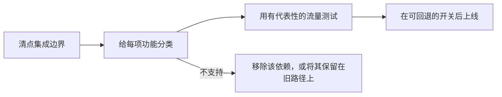

找出当前网关集成用到的每项功能，然后在迁移流量之前完成最后一列要求的事。最近审核日期：2026 年 11 月 4 日。

按以下顺序进行迁移。即使两个平台都接受相同的 OpenAI 兼容请求，这个顺序也能找出可能发生变化的行为。

## 清点集成边界

记录当前网关出现的每一处，避免迁移后留下第二条隐藏的配置路径：

- base URL 和 API 密钥环境变量；
- SDK 初始化和自定义请求头；
- 模型 ID 和回退模型；
- 提供商排序、允许列表和隐私要求；
- 流式传输、工具调用和结构化输出代码；
- 批处理任务、文件、webhook 和异步状态轮询；
- 请求归因以及用户或会话元数据。

## 请求

| 功能 | 在 Phaseo 上 | 切换前 |
| --- | --- | --- |
| 身份验证 | `Authorization: Bearer $PHASEO_API_KEY` | 更换 base URL 和密钥，然后运行一次带身份验证的请求。 |
| Chat Completions | `/v1/chat/completions` | 测试普通、流式、工具调用和结构化输出请求。未知的顶层字段会返回 `400`。 |
| Responses | `/v1/responses`，不保存状态 | 测试输入格式、流式事件、工具和解析。`previous_response_id` 和 `conversation` 会返回 `400`；请发送完整历史。 |
| Anthropic Messages | 根主机 `https://api.phaseo.app` 上的 `/v1/messages` | 以 bearer 令牌形式传递密钥，并检查每个 `anthropic-beta` 请求头；Phaseo 不会转发它们。 |
| 模型 ID | `<org>/<model>` | 在 `GET /v1/models?format=openai` 中核对每个生产 ID。不要假定别名一致。 |
| 嵌入、图像、音频、内容审核 | 按模型和提供商支持 | 确认模型支持该操作。 |

## 路由和策略

| 功能 | 在 Phaseo 上 | 切换前 |
| --- | --- | --- |
| 模型回退 | `models` 数组，1 到 25 项 | 回退在 `429`、`500`、`502`、`503` 和 `504` 时触发，请求错误时从不触发。 |
| 提供商顺序 | `provider.order` | 只重建工作负载仍然需要的排序。 |
| 提供商允许和忽略列表 | `provider.only`、`provider.ignore` | 检查提供商 ID，并确认至少还剩一条路由。 |
| 按价格、延迟或吞吐量排序 | `provider.sort` | 测试后，在请求详情中查看所选的提供商。 |
| 零数据保留 | `provider.require_zero_data_retention`（别名 `provider.zdr`） | 强制启用前，确认模型有匹配的提供商。 |
| 区域执行和数据驻留 | `provider.required_execution_region`、`provider.required_data_region`、工作区隐私默认设置 | 同时测试成功的路由和没有匹配提供商时的错误。 |
| 共享提示词和默认设置 | [预设](../guides/presets) | 把共享配置移入预设，而不是复制到每个调用方。 |

## 运营

| 功能 | 在 Phaseo 上 | 切换前 |
| --- | --- | --- |
| 应用归因 | `X-App-Id`、`X-App-Name`、`HTTP-Referer`、`X-Title`、`X-App-Categories` | 保留描述调用应用的请求头；迁移时丢掉它们会让成本和用量比较更困难。在控制台中检查应用分组。类别取值参见[应用归因](../guides/app-attribution)。 |
| 成本标签 | `X-Phaseo-Metadata` 标签 | 把自定义属性或标记映射为标签。 |
| 请求详情 | 请求日志和 `GET /v1/generations?id=<request_id>` | 对有代表性的提示词比较提供商、延迟、token 用量和价格。 |
| 重放 | `replay_supported` 为 `true` 时使用 `replay_request` | 确认失败请求的接口和载荷可以找回。 |
| 批处理和异步任务 | 批处理、文件、视频、webhook 和 WebSocket API | 检查状态转换、终态计费、取消和结果获取。`/v1/files` 只存放批处理输入。 |
| 速率限制 | 按用户的每分钟请求数额度，新工作区从 10 开始 | 通过同一个密钥所有者发送整个团队流量的代理可能会触及上限。参见[限制](../api-reference/limits)。 |
| 渐进式上线 | 在客户端或基础设施层拆分流量 | 在切换稳定之前，让回退只需更改 base URL 和密钥。 |

## 不可用

以下功能在 Phaseo 中没有对应项。请把它们保留在应用中或旧平台上：

- **响应缓存。** Phaseo 不缓存响应。[提示词缓存](../guides/prompt-caching)仍然可以降低输入成本。
- **已存储的响应和对话。** 没有 `GET` 或 `DELETE /v1/responses/{id}`。
- **token 计数**（`/v1/messages/count_tokens`）。
- **OpenAI Assistants、Threads、向量存储、微调和旧版 `/v1/completions`。**

## 给每项功能分类

根据上面的表格和你的[源平台](./index#platform-migrations)指南，为每个生产行为指定一个状态：

| 状态 | 含义 |
| --- | --- |
| 不变 | 已验证请求字段和响应行为相同。 |
| 已映射 | Phaseo 通过不同的字段或设置给出相同结果。 |
| 已适配 | 兼容层会转换请求或响应。 |
| 不支持 | 移除该依赖，或把该工作负载保留在当前路径上。 |
| 未验证 | 可能已支持，但还没有类似生产环境的证据。 |

## 用你自己的流量验证

API 兼容并不能让以下方面表现一致：

- 自动提供商选择和回退顺序；
- 提示词缓存亲和性和缓存价格；
- 提供商特有的请求字段和仅在响应中出现的元数据；
- 速率限制和重试时机；
- 数据保留、驻留和训练政策；
- 具体的模型可用性和价格。

根据真实的工作负载模式构建一个小型测试集（不要复制敏感的生产数据），并运行：

1. 对每个在用的接口发送一次普通请求；
2. 通过与生产相同的客户端路径进行流式传输；
3. 使用真实 schema 的工具调用和结构化输出；
4. 每一项提供商或隐私约束；
5. 无效密钥、无效模型、速率限制和提供商不可用时的失败；
6. 批处理或异步任务的成功、失败和取消。

比较输出质量、延迟、token 用量、所选提供商和最终成本。记录每个请求 ID，以便在请求日志中或用 `GET /v1/generations?id=<request_id>` 查看。

## 用可回退的开关上线

先从开发和内部流量开始。只有在测试集通过后，才迁移一小部分生产流量；在结果稳定之前，让回退只涉及 base URL 和密钥。不要把切换和提示词、模型或路由的修改放在一起；等网关边界验证完成后再做这些修改。
