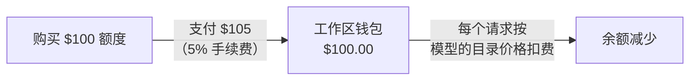

一次性购买额度，然后按每个模型的目录价格用于请求。Phaseo 对托管请求收取的唯一费用是每次购买额度金额的 5%，最低 $1；请求本身不加价。

## 充值的费用

手续费取所购额度的 5% 与 $1 中的较大者，并加到你支付的金额上。

| 你购买的额度 | 手续费 | 你支付的金额 |
| ---: | ---: | ---: |
| $5.00 | $1.00（最低） | $6.00 |
| $20.00 | $1.00 | $21.00 |
| $100.00 | $5.00 | $105.00 |
| $1,000.00 | $50.00 | $1,050.00 |

反过来看，一笔 $100.00 的扣款会增加 $95.24 的额度，并收取 $4.76 的手续费。控制台充值最低 $5。

在 **设置 -> 账单 -> 账单和额度** 中购买额度，或在终端中运行 `phaseo credits add --amount <usd>`（参见[快速开始](../quickstart#add-credits-for-paid-models)）。同一页面会显示你的余额、当前手续费和近期支出；**设置 -> 账单 -> 交易** 列出每笔购买。

## 哪些用量不消耗额度

| 用量 | Phaseo 收费 |
| --- | --- |
| 免费模型（`phaseo/free` 和定价为 $0 的模型） | 无。免费模型请求有每日额度；参见[套餐](../exploring/subscription-plans)。 |
| 自带密钥（BYOK） | 无需充值。每个工作区每个 UTC 月的前 250,000 个已完成 BYOK 请求不收服务费，之后按提供商等价成本的 2.5% 收取。模型用量由你的提供商计费。参见 [BYOK 注意事项](../guides/routing-and-fallbacks#byok-considerations)。 |

## 企业版

Self Serve Enterprise 是单独的月度订阅，提供 SSO、SCIM、目录管理、部门和优先电子邮件支持。最多 100 名工作区成员时起价为 $29/月，1,000 名成员时为 $79/月。它不包含额度，也不改变 5% 的手续费（最低 $1）。完整的成员价格以及成员的计算方式，请参见[套餐](../exploring/subscription-plans#enterprise-member-pricing)。

如需开具发票、采购流程或定制商务条款，请联系[帮助中心](https://phaseo.app/help)。标准的 Gateway 用量不需要企业版。
