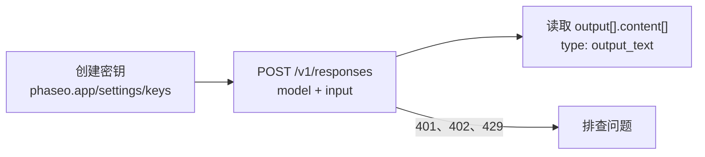

创建 API 密钥，向 `POST /v1/responses` 发送一个请求，然后从 `output_text` 读取回复。



<Prompt description="**使用编程智能体？** 开始前先粘贴这个提示。" icon="bot" actions={["copy", "cursor"]}>
{`You are integrating this project with Phaseo Gateway.

Before editing anything:
- Install the Phaseo skills: npx skills add https://phaseo.app/docs
- Read https://phaseo.app/docs/skill.md and the API reference for the endpoint you will use. If your tools support MCP, search the docs at https://phaseo.app/docs/mcp.
- Inspect the existing provider configuration and identify the smallest safe change.

Rules:
- Call https://api.phaseo.app/v1 with a server-side PHASEO_API_KEY. Never print or commit credentials.
- Keep the current provider and model behaviour unless I ask for a migration. Check model IDs with GET /v1/models instead of guessing them.
- Explain the files you would change and the verification commands first.
- Do not deploy, rotate keys, send external messages, or make unrelated edits without my approval.`}
</Prompt>

<Visibility for="agents">
面向智能体的快速入门清单：

- 请对方在控制台的 **设置 -> API 密钥** 下创建密钥，或使用管理密钥调用 `POST /v1/keys` 创建；CLI 登录无法创建密钥。不要生成或猜测密钥。只在服务端代码中以 `Authorization: Bearer phaseo_v1_sk_<kid>_<secret>` 的形式发送它。
- 使用付费模型时，先运行一次 `phaseo login --scopes billing:write`，然后用 `phaseo credits add --amount <usd> --json` 发起充值。如果有已保存的银行卡，由工作区所有者或管理员通过邮件中的链接确认。如果没有已保存的银行卡，响应中会包含 `next_action: "open_checkout_url"` 和一个支付链接，由所有者或管理员打开并付款；银行卡随后会保存下来，供之后充值使用。不要为了额度或 CLI 能完成的其他任务把用户引导到控制台；请参阅 https://phaseo.app/docs/zh-Hans/v1/developers/manage-from-an-agent.md。
- 第一个请求使用 `POST https://api.phaseo.app/v1/responses`，发送 `model` 和 `input`。示例使用 `openai/gpt-6-astra`，这是需要额度的付费模型。`phaseo/free` 会选择一个可用的免费模型，无需钱包余额即可使用。
- 从 `output[].content[]` 中 `type` 为 `output_text` 的项读取回复。
- 如果请求失败，请按照 https://phaseo.app/docs/zh-Hans/v1/api-reference/errors.md 中的说明，根据 JSON 中的 `error` 代码分别处理。
</Visibility>

## 1. 创建 API 密钥

在[控制台](https://phaseo.app/settings/keys)的 **设置 -> API 密钥** 下创建密钥，然后导出它：

```bash
export PHASEO_API_KEY="phaseo_v1_sk_..."
```

密钥只显示一次。每个请求都把它作为 bearer 令牌发送：

```http
Authorization: Bearer phaseo_v1_sk_<kid>_<secret>
```

<Danger>
请像对待密码一样对待 API 密钥。把它放在服务端代码中，永远不要把它发布到浏览器或移动应用中。
</Danger>

<span id="add-credits-for-paid-models"></span>
### 为付费模型充值额度

`phaseo/free` 无需额度即可使用。`openai/gpt-6-astra` 等付费模型需要钱包余额：

```bash
phaseo login --scopes billing:write   # once; credit top-ups need this scope
phaseo credits add --amount 20
```

如果有已保存的银行卡，由工作区所有者或管理员通过邮件中的链接确认扣款。如果没有已保存的银行卡，命令会返回一个支付链接，由所有者或管理员打开并付款，银行卡会保存下来供之后充值使用。

## 2. 发送文本请求

`POST /v1/responses` 是新文本工作的推荐端点。示例使用付费模型 `openai/gpt-6-astra`。如需在没有额度的情况下测试，请把它换成 `phaseo/free`，它会选择一个可用的免费模型；参见[从免费路由器开始上线](./cookbook/free-router-first-deploy)。

cURL 和 `fetch` 无需安装任何内容。如需使用 SDK，请先安装：

<CodeGroup>
```bash npm
npm install @phaseo/sdk
```

```bash pnpm
pnpm add @phaseo/sdk
```

```bash pip
pip install phaseo
```
</CodeGroup>

运行环境要求和其他 SDK 请参阅 [TypeScript 和 Python 安装页面](./sdk-reference/client/installation)。

<CodeGroup>
```bash cURL
curl https://api.phaseo.app/v1/responses \
  -H "Authorization: Bearer $PHASEO_API_KEY" \
  -H "Content-Type: application/json" \
  -d '{
    "model": "openai/gpt-6-astra",
    "input": "Reply with: quickstart works"
  }'
```

```javascript JavaScript
const response = await fetch("https://api.phaseo.app/v1/responses", {
  method: "POST",
  headers: {
    Authorization: `Bearer ${process.env.PHASEO_API_KEY}`,
    "Content-Type": "application/json",
  },
  body: JSON.stringify({
    model: "openai/gpt-6-astra",
    input: "Reply with: quickstart works",
  }),
});

const data = await response.json();
const assistantText = data.output
  ?.find((item) => item.type === "message")
  ?.content?.find((part) => part.type === "output_text")
  ?.text;

console.log(assistantText);
```

```typescript TypeScript SDK
import Phaseo, { outputText } from "@phaseo/sdk";

const client = new Phaseo(); // reads PHASEO_API_KEY

const response = await client.generateResponse({
  model: "openai/gpt-6-astra",
  input: "Reply with: quickstart works",
});

console.log(outputText(response));
```

```python Python SDK
from phaseo import Phaseo

client = Phaseo()  # reads PHASEO_API_KEY

response = client.responses.create(
    {
        "model": "openai/gpt-6-astra",
        "input": "Reply with: quickstart works",
    }
)

print(response.output_text)
```

```go Go SDK
package main

import (
  "context"
  "fmt"

  phaseo "github.com/phaseoteam/Phaseo/packages/sdk/sdk-go/v3"
)

func main() {
  client := phaseo.MustNewFromEnv() // reads PHASEO_API_KEY

  response, err := client.GenerateResponse(context.Background(), phaseo.ResponsesRequest{
    Model: "openai/gpt-6-astra",
    Input: "Reply with: quickstart works",
  })
  if err != nil {
    panic(err)
  }

  fmt.Println(response)
}
```

```csharp C# SDK
using PhaseoSdk;
using System.Collections.Generic;

var client = new Phaseo(); // reads PHASEO_API_KEY

var response = await client.GenerateResponse(new Dictionary<string, object>
{
    ["model"] = "openai/gpt-6-astra",
    ["input"] = "Reply with: quickstart works",
});

Console.WriteLine(response);
```

```php PHP SDK
<?php
require 'vendor/autoload.php';

use Phaseo\Sdk\Phaseo;

$client = new Phaseo(getenv('PHASEO_API_KEY'));

$response = $client->generateResponse([
    'model' => 'openai/gpt-6-astra',
    'input' => 'Reply with: quickstart works',
]);

print_r($response);
```

```ruby Ruby SDK
require 'phaseo_sdk'

client = PhaseoSdk::Phaseo.new # reads PHASEO_API_KEY

response = client.generate_response(
  model: 'openai/gpt-6-astra',
  input: 'Reply with: quickstart works',
)

puts response
```

```java Java SDK
// Build from source: https://phaseo.app/docs/v1/sdk-reference/client/installation
import app.phaseo.sdk.Phaseo;
import java.util.Map;

public class Main {
    public static void main(String[] args) throws Exception {
        var client = new Phaseo(System.getenv("PHASEO_API_KEY"));
        var response = client.createResponse(Map.of(
            "model", "openai/gpt-6-astra",
            "input", "Reply with: quickstart works"
        ));
        for (var item : response.path("output")) {
            for (var part : item.path("content")) {
                if ("output_text".equals(part.path("type").asText())) {
                    System.out.println(part.path("text").asText());
                }
            }
        }
    }
}
```

```rust Rust SDK
use phaseo::Phaseo;
use serde_json::{json, Value};

fn main() -> Result<(), Box<dyn std::error::Error>> {
    let client = Phaseo::from_env()?;
    let response = client.responses(&json!({
        "model": "openai/gpt-6-astra",
        "input": "Reply with: quickstart works"
    }))?;

    let assistant_text = response.body
        .get("output")
        .and_then(Value::as_array)
        .into_iter()
        .flatten()
        .filter(|item| item.get("type").and_then(Value::as_str) == Some("message"))
        .flat_map(|item| {
            item.get("content")
                .and_then(Value::as_array)
                .into_iter()
                .flatten()
        })
        .find_map(|part| {
            (part.get("type").and_then(Value::as_str) == Some("output_text"))
                .then(|| part.get("text").and_then(Value::as_str))
                .flatten()
        })
        .unwrap_or("");

    println!("{assistant_text}");
    Ok(())
}
```

```typescript Vercel AI SDK
import { phaseo } from "@phaseo/ai-sdk-provider";
import { generateText } from "ai";

const result = await generateText({
  model: phaseo("openai/gpt-6-astra"),
  prompt: "Reply with: quickstart works",
});

console.log(result.text);
```
</CodeGroup>

## 3. 读取回复

```json
{
  "id": "G-...",
  "nativeResponseId": "resp_...",
  "object": "response",
  "created_at": 1730000000,
  "status": "completed",
  "completed_at": 1730000001,
  "model": "openai/gpt-6-astra",
  "output": [
    {
      "type": "message",
      "id": "msg_...",
      "status": "completed",
      "role": "assistant",
      "content": [{ "type": "output_text", "text": "quickstart works", "annotations": [] }]
    }
  ],
  "usage": {
    "input_tokens": 9,
    "output_tokens": 3,
    "total_tokens": 12
  },
  "error": null,
  "incomplete_details": null
}
```

| 字段 | 内容 |
| --- | --- |
| `output[].content[]` 中 `type: "output_text"` 的项 | 回复文本。TypeScript 的 `outputText()` 辅助函数和 Python 的 `response.output_text` 会替你读取它；Vercel AI SDK 将它作为 `result.text` 返回。 |
| `id` | Phaseo 请求 ID。该请求会出现在 **设置 -> 使用情况 -> 日志 -> 请求** 下。 |
| `nativeResponseId` | 提供商为同一响应分配的 ID。 |
| `usage` | 该请求计费的输入、输出和总 token 数。 |

### 流式输出回复

使用流式输出，可以在回复生成时就把它打印出来。每个 `response.output_text.delta` 事件的 `text` 只包含新增文本，因此这个循环只会打印一次答案。`response.output_text.done` 等结束事件会重复已经流式输出过的文本。完整事件列表请参阅[流式输出](./guides/streaming)。

<CodeGroup>
```typescript TypeScript SDK
import Phaseo from "@phaseo/sdk";

const client = new Phaseo(); // reads PHASEO_API_KEY

for await (const chunk of client.streamResponses({
  model: "openai/gpt-6-astra",
  input: "Reply with: quickstart works",
})) {
  if (chunk.type === "response.output_text.delta") process.stdout.write(chunk.text);
}
```

```python Python SDK
from phaseo import Phaseo

client = Phaseo()  # reads PHASEO_API_KEY

for chunk in client.stream_responses(
    {
        "model": "openai/gpt-6-astra",
        "input": "Reply with: quickstart works",
    }
):
    if chunk.get("type") == "response.output_text.delta":
        print(chunk["text"], end="", flush=True)
print()
```
</CodeGroup>

## 4. 排查第一个请求的问题

| 状态码 | 检查项 |
| --- | --- |
| `401` | API 密钥和 `Authorization: Bearer` 请求头。 |
| `400` | 请求正文和模型 ID。用 `GET /v1/models` 列出有效 ID。 |
| `402` | 你的额度余额。充值额度或改用 `phaseo/free`。 |
| `429` 或 `5xx` | 使用指数退避重试。 |

[错误参考](./api-reference/errors)列出了每个错误代码及其处理方法。

## 获取带类型的答案而不是文本

当代码需要的是一个值而不是一段文字时，把问题发送到 `POST /v1/decisions`（Beta）。每个答案都带类型和概率返回，顺序与问题相同。问题类型有 `predicate`（是/否）、`choice`（从你的选项中选一个）和 `score`（你的量表上的一个等级）。

<CodeGroup>
```bash cURL
curl https://api.phaseo.app/v1/decisions \
  -H "Authorization: Bearer $PHASEO_API_KEY" \
  -H "Content-Type: application/json" \
  -d '{
    "model": "openai/gpt-6-luna",
    "input": "I was charged twice and need a refund. I cannot log in to pay my team.",
    "questions": [
      {
        "type": "choice",
        "name": "department",
        "instructions": "Which team should handle this request?",
        "choices": [
          { "value": "billing", "description": "Payments, invoices, refunds and duplicate charges" },
          { "value": "support", "description": "Product usage and troubleshooting" }
        ]
      },
      {
        "type": "predicate",
        "name": "is_urgent",
        "instructions": "Is the customer blocked from using the product?"
      }
    ]
  }'
```

```typescript TypeScript SDK
import Phaseo from "@phaseo/sdk";

const client = new Phaseo(); // reads PHASEO_API_KEY

const decision = await client.decisions.create({
  model: "openai/gpt-6-luna",
  input: "I was charged twice and need a refund. I cannot log in to pay my team.",
  questions: [
    {
      type: "choice",
      name: "department",
      instructions: "Which team should handle this request?",
      choices: [
        { value: "billing", description: "Payments, invoices, refunds and duplicate charges" },
        { value: "support", description: "Product usage and troubleshooting" },
      ],
    },
    {
      type: "predicate",
      name: "is_urgent",
      instructions: "Is the customer blocked from using the product?",
    },
  ],
});

console.log(decision.answers);
```

```python Python SDK
from phaseo import Phaseo

client = Phaseo()  # reads PHASEO_API_KEY

decision = client.decisions.create(
    {
        "model": "openai/gpt-6-luna",
        "input": "I was charged twice and need a refund. I cannot log in to pay my team.",
        "questions": [
            {
                "type": "choice",
                "name": "department",
                "instructions": "Which team should handle this request?",
                "choices": [
                    {"value": "billing", "description": "Payments, invoices, refunds and duplicate charges"},
                    {"value": "support", "description": "Product usage and troubleshooting"},
                ],
            },
            {
                "type": "predicate",
                "name": "is_urgent",
                "instructions": "Is the customer blocked from using the product?",
            },
        ],
    }
)

print(decision["answers"])
```
</CodeGroup>

响应（数值仅作示意）：

```json
{
  "model": "openai/gpt-6-luna",
  "answers": [
    {
      "type": "choice",
      "name": "department",
      "choice": "billing",
      "confidence": 0.89,
      "probabilities": [
        { "value": "billing", "probability": 0.91 },
        { "value": "support", "probability": 0.09 }
      ]
    },
    { "type": "predicate", "name": "is_urgent", "probability": 0.84 }
  ],
  "usage": { "input_tokens": 42, "output_tokens": 18, "total_tokens": 60 }
}
```

读取 `answers[0].choice` 或 `answers[1].probability`，并用 `confidence` 或 `probabilities` 设置你自己的阈值。[Decisions 参考](./api-reference/endpoint/decisions)列出了每个决策模型、它的限制和价格、图片输入，以及带命名问题映射（`noul`、`criteria`）的旧版 `state` 格式；旧格式仍然可用，某些模型也必须使用它。

## 生成视频

视频生成是异步的：先创建任务，再轮询它，然后下载文件。

```bash
# 1. 创建任务
curl https://api.phaseo.app/v1/videos \
  -H "Authorization: Bearer $PHASEO_API_KEY" \
  -H "Content-Type: application/json" \
  -d '{
    "model": "google/veo-3.1-fast",
    "prompt": "A cinematic sunrise over a mountain lake"
  }'

# 2. 轮询，直到状态变为 completed
curl https://api.phaseo.app/v1/videos/VIDEO_ID \
  -H "Authorization: Bearer $PHASEO_API_KEY"

# 3. 下载视频
curl https://api.phaseo.app/v1/videos/VIDEO_ID/content \
  -H "Authorization: Bearer $PHASEO_API_KEY" \
  -o video.mp4
```

如需用 webhook 代替轮询，请参阅[异步任务与 Webhook](./guides/async-video-and-batch)。

## 继续构建

<Columns cols={2}>
	<Card title="集成 Gateway" icon="plug" href="./developers/integrating-with-the-gateway">
		选择端点并搭建生产环境集成。
	</Card>
	<Card title="API 参考" icon="book" href="./api-reference/introduction">
		每个端点的全部请求和响应字段。
	</Card>
	<Card title="示例" icon="code" href="./guides/examples">
		常见工作流的入门应用。
	</Card>
	<Card title="支持" icon="message-circle" href="https://phaseo.app/help">
		获取有关调试、路由和模型行为的帮助。
	</Card>
</Columns>
