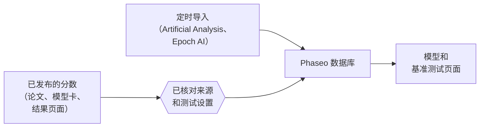

Phaseo 发布由他人测得的基准测试分数，每个分数都附有来源链接。Phaseo 不运行基准测试，也不把分数合并成一个总分。

## 分数从哪里来

| 来源 | 进入方式 |
| --- | --- |
| 模型开发方的论文、模型卡和公告 | 由维护者添加，标记为**自报** |
| 基准测试组织方的结果页面 | 由维护者添加 |
| Artificial Analysis 和 Epoch AI 指数 | 定时导入，每小时检查一次 |
| 社区报告 | 通过 GitHub issue 提交，维护者核对证据后发布 |

每个分数在发布前都需要有公开来源或可复现的评估日志。

## 规范化指的是什么

Phaseo 让每个基准测试保持各自的分值范围。它规范化的是分数周围的记录，而不是分数本身：

1. 每个结果都映射到一个基准测试 ID，这样名称不同的同一基准测试会被归为一组。
2. 测试设置不同时（例如 few-shot 数量、评测框架或推理 effort），会作为变体保留，而不是合并到默认设置中。
3. 每个基准测试都有排序方向。越低越好的基准测试（例如错误率）会把最低分排在最前。
4. 来源链接和自报标记始终与分数一起保留。

自报标记是一种披露，而不是否定。缺少足够上下文的分数可能会带着来源备注存储；不要把它等同于经过完整验证的排行榜条目。

## 报告差异

1. 按照[提交基准测试分数](./submitting-scores.mdx)中列出的证据要求提交 issue。
2. 在 issue 中回答审核问题。维护者会通过数据库编辑器发布经过验证的更正。
3. 对于较大的研究提交，请在 [Discord](https://discord.gg/aQyywCvgZ5) 中协调。

公开的[基准测试规范化](https://phaseo.app/how-phaseo-normalises-ai-benchmarks)页面为目录读者介绍了同样的规则。
