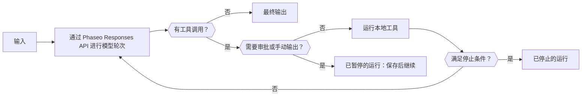

当一次请求不够用时，就使用 Phaseo Agent SDK：SDK 在你的进程中运行一个有边界的循环，把每一轮发送到 Responses API，运行模型调用的工具，并在某个工具需要审批时暂停等待人工处理。运行状态由你保存；Phaseo 不为智能体托管任何内容。

## 选择你的包

| 语言 | 包 | 版本 | 它安装的核心客户端 |
| --- | --- | --- | --- |
| TypeScript | [`@phaseo/agent-sdk`](https://www.npmjs.com/package/@phaseo/agent-sdk) | 0.3.0 | `@phaseo/sdk` |
| Python | [`phaseo-agent-sdk`](https://pypi.org/project/phaseo-agent-sdk/)（模块 `phaseo_agent`） | 0.3.0 | `phaseo` 3.x |
| Go | [`github.com/phaseoteam/Phaseo/packages/sdk/agent-sdk-go`](https://pkg.go.dev/github.com/phaseoteam/Phaseo/packages/sdk/agent-sdk-go) | v0.3.0 | `sdk-go/v3` |
| C# | [`Phaseo.AgentSdk`](https://www.nuget.org/packages/Phaseo.AgentSdk) | 0.3.0 | `Phaseo.Sdk` |
| PHP | [`phaseo/agent-sdk`](https://packagist.org/packages/phaseo/agent-sdk) | v0.3.0 | `phaseo/sdk` `^3.0.0` |
| Ruby | [`phaseo_agent_sdk`](https://rubygems.org/gems/phaseo_agent_sdk) | 0.3.0 | `phaseo_sdk` `>= 3.0.0, < 4.0.0` |
| Java | `app.phaseo:phaseo-agent-sdk`（Maven Central） | 0.3.0 | `app.phaseo:phaseo-sdk` 3.0.0 |
| Rust | [`phaseo-agent`](https://crates.io/crates/phaseo-agent) | 0.2.0 | `phaseo` 0.2 |

TypeScript 是参考设计。C++ 没有 Agent SDK。[安装](./installation)列出了安装命令和运行时要求，[用法](./usage)会带你构建第一个智能体。

<Prompt description="让编程智能体用你所用语言的 Phaseo Agent SDK 构建第一个智能体。" icon="bot" actions={["copy", "cursor"]}>
{`Build a small agent in this project with the Phaseo Agent SDK.

1. Install the Phaseo skills: npx skills add https://phaseo.app/docs
   For TypeScript, follow the phaseo-agent-sdk-typescript skill.
2. Read the Agent SDK pages at https://phaseo.app/docs/v1/sdk-reference/agent/overview, pick this project's language tab, and use only the APIs it documents.
3. Define one agent with at most two local tools that fit [AGENT TASK]. Keep the loop bounded with a step limit, and require approval for any tool that changes data.
4. Use a server-side PHASEO_API_KEY and check the model ID with GET /v1/models before using it.
5. Stream the agent's steps to the console so a run can be inspected.
6. Run the agent once, then report what you verified and what you could not verify.`}
</Prompt>

## 比较各运行时支持的功能

每个 SDK 都能运行本地工具，按精确的工具调用 ID 暂停以等待审批或手动输出，并返回由你的应用保存的可序列化运行状态。其余功能因语言而异：

| 功能 | TypeScript | Python | Go | C# | PHP | Ruby | Java | Rust |
| --- | --- | --- | --- | --- | --- | --- | --- | --- |
| 默认步数上限 | 12 | 12 | 8 | 12 | 12 | 12 | 12 | 8 |
| 达到步数上限 | 抛出 `Max steps exceeded` | 抛出 `RuntimeError` | 返回错误 | 抛出 `InvalidOperationException` | 抛出异常 | 抛出异常 | 抛出异常 | 返回 `stopped` 运行（`max_steps:N`） |
| 模型流式传输 | 异步可迭代对象 | 迭代器（后台线程） | Channel | 异步可枚举对象 | 可迭代对象；只在你迭代时运行（Fiber） | Enumerator（工作线程） | 运行结束后返回列表；通过 `onEvent` 实时获取 | 暂不支持 |
| 工具进度事件 | 异步生成器 | `emit_progress` 或生成器 | `EmitProgress` | `EmitProgress` | `emitProgress` | `emit_progress` | `emitProgress` | 暂不支持 |
| 并发工具 | 是 | 是（线程） | 是 | 是 | 否 | 是（线程） | 是（线程池） | 否 |
| 工具超时 | 中止 `context.signal` | 让运行失败；线程继续运行 | 让调用失败；goroutine 继续运行 | 取消 `CancellationToken` | 在工具返回后检查 | 中断调用 | 中断线程 | 无 |
| 运行时 schema 校验 | 是 | 是 | 是 | 是 | 是 | 是 | 是 | 否；JSON Schema 只发送给模型 |
| 默认的工具错误处理 | 让运行失败 | 让运行失败 | 让运行失败 | 让运行失败 | 让运行失败 | 让运行失败 | 让运行失败 | 返回给模型 |
| 按调用 ID 批准和拒绝 | 是 | 是 | 是 | 是 | 是 | 是 | 是 | 仅支持批准 |
| 交互式（人在回路）工具 | 是 | 是 | 是 | 是 | 是 | 是 | 是 | 仅智能体级 `human_review` |
| 停止条件 | 可组合 | 可组合；只在没有工具调用的步骤上检查 | 可组合 | 可组合 | 可组合 | 可组合 | 可组合 | 步数上限 |
| 动态轮次 | 是 | 模型、指令和采样参数；工具通过 `next_turn_params` | 是 | 是 | 是 | 是 | 是 | 按运行设置模型、步数上限和上下文 |
| 带类型的时间线条目 | `AgentItem` 联合类型 | 字典 | `Details` 映射 | `Details` 字典 | 数组 | 哈希 | `details()` 映射 | 否；读取 `messages` 和 `steps` |
| 用量和费用 | 是 | 是 | 是 | 是 | 是 | 是 | 是 | token 数，响应包含 `meta.cost` 或 `cost` 时还有费用 |
| 取消 | `cancel()` | `cancel()` | Context | `CancellationToken` | `cancel()` | `cancel` | `cancel()` | 暂不支持 |
| Devtools 捕获 | 是 | 是 | 是 | 是 | 是 | 是 | 是 | 暂不支持 |

Rust（`phaseo-agent` 0.2）是同步的：没有流式传输、异步执行、并发工具、运行时 schema 校验或 Devtools 捕获。如果运行不应阻塞请求处理函数，就在工作线程上运行它。PHP 一次只运行一个工具，它的流也只在你的代码迭代时才会推进。

## 选择 Agent SDK、客户端还是原始 API

| 用途 | 选择 | 它负责的部分 |
| --- | --- | --- |
| 单个 API 请求或完整的端点覆盖 | [客户端 SDK](../client/overview) | 生成的 API 类型和传输 |
| 使用工具的多步骤应用逻辑 | Agent SDK | 本地循环、工具、检查点、审核、事件和 Devtools |
| 自定义传输或不受支持的语言 | 原始 API | HTTP 请求和响应处理 |

每个 Agent SDK 的网关客户端都通过该语言的客户端 SDK 发送模型轮次。大多数都接受一个 `requestOptions` 映射（或该语言的等价物），用于传入额外的 Responses API 字段；智能体仍然会设置 `model`、`input`、`instructions` 和它的函数工具。Rust 0.2 适配器只发送规范化后的智能体字段，没有额外选项的钩子。

## 从示例方案开始

| 示例方案 | 语言 |
| --- | --- |
| [构建持久的智能体循环](../../cookbook/agent-sdk-durable-loop) | TypeScript |
| [用结构化输出和网页搜索做研究](../../cookbook/agent-sdk-research-brief) | TypeScript |
| [使用预设并感知护栏失败的支持分诊](../../cookbook/agent-sdk-support-triage) | TypeScript |
| [用运行时工具运行代码审查智能体](../../cookbook/agent-sdk-coding-review) | TypeScript |
| [并发展开本地智能体工具](../../cookbook/agent-sdk-parallel-tools) | TypeScript |
| [提取结构化 JSON](../../cookbook/agent-sdk-python-structured-extraction) | Python |
| [构建运维手册智能体](../../cookbook/agent-sdk-go-ops-runbook) | Go |
| [分诊工单](../../cookbook/agent-sdk-csharp-ticket-triage) | C# |
| [审核 CMS 内容](../../cookbook/agent-sdk-php-content-review) | PHP |
| [总结内部笔记](../../cookbook/agent-sdk-ruby-rag-notes) | Ruby |

借助这些页面上的 API，TypeScript 示例方案可以移植到任何语言。
