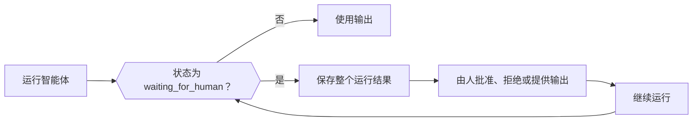

当智能体需要人工处理、外部任务，或需要由你的应用运行某个工具时，运行会正常返回（而不是作为错误），状态为 `waiting_for_human`，并带有继续运行所需的全部信息。保存整个结果，在你的应用中收集决定，然后把保存的结果和决定传给智能体的继续方法。



<Note>
Phaseo 不保存 Agent SDK 运行。如果可恢复的状态必须在请求或进程重启后保留下来，请把它保存在你自己的应用中。
</Note>

| 语言 | 继续 | 以流式方式继续 | 说明 |
| --- | --- | --- | --- |
| TypeScript | `agent.continueRun()` | `agent.continueStream()` | |
| Python | `agent.continue_run()` | `agent.continue_stream()` | |
| Go | `agent.Continue(ctx, ContinueOptions)` | `agent.ContinueStream` | |
| C# | `agent.ContinueRun(ContinueOptions)` | `agent.ContinueStream` | |
| PHP | `$agent->continueRun()` | `$agent->continueStream()` | `continueRunById()` 会先从状态访问器加载运行 |
| Ruby | `agent.continue_run` | `agent.continue_stream` | |
| Java | `agent.continueRun(ContinueOptions)` | `agent.continueStream` | `ContinueOptions` 是按位置传参的 record |
| Rust | `agent.continue_run(&mut client, options)` | 无 | `continue_with_events` 增加了事件回调；运行是同步的 |

## 批准或拒绝工具调用

需要审批的工具、手动工具和人在回路工具会在执行前暂停运行。每个待处理调用都包含模型的 `call`（带有它的 `id`）和一个 `kind`：`approval`、`manual` 或 `hitl`。请按精确的调用 ID 而不是工具名称回应每个调用，这样对同一工具的两次调用就能区分开。

被批准的调用会运行它的工具。被拒绝的调用会把 `{"error": "<reason>"}` 作为工具结果发给模型，默认原因是 `Tool call rejected`。

<CodeGroup>

```typescript TypeScript
const resumed = await agent.continueRun({
  run: paused,
  client,
  approvals: [{ toolCallId: "call_deploy_42" }],
  rejections: [
    { toolCallId: "call_delete_17", reason: "Not authorized" },
  ],
});
```

```python Python
from phaseo_agent import AgentToolDecision

pending = paused.run.pause.pending_tool_calls

continued = agent.continue_run(
    run=paused,
    client=client,
    approvals=[AgentToolDecision(pending[0].call.id)],
    rejections=[AgentToolDecision(pending[1].call.id, "Not authorized")],
)
```

```go Go
var approvals, rejections []phaseoagent.ToolDecision
for _, pending := range result.Run.Pause.PendingToolCalls {
  if pending.Kind != "approval" {
    continue
  }
  if userApproved(pending.Call) {
    approvals = append(approvals, phaseoagent.ToolDecision{ToolCallID: pending.Call.ID})
  } else {
    rejections = append(rejections, phaseoagent.ToolDecision{ToolCallID: pending.Call.ID, Reason: "Not now"})
  }
}

result, err = agent.Continue(ctx, phaseoagent.ContinueOptions{
  Run: result, Client: client, Approvals: approvals, Rejections: rejections,
})
```

```csharp C#
var pending = result.Run.Pause!.PendingToolCalls!.Where(item => item.Kind == "approval");

result = await agent.ContinueRun(new ContinueOptions
{
    Run = result,
    Client = client,
    Approvals = pending.Where(item => UserApproved(item.Call)).Select(item => new ToolDecision(item.Call.Id)).ToList(),
    Rejections = pending.Where(item => !UserApproved(item.Call)).Select(item => new ToolDecision(item.Call.Id, "Not now")).ToList(),
});
```

```php PHP
use Phaseo\AgentSdk\ToolDecision;

$approvals = $rejections = [];
foreach ($result->run->pause->pendingToolCalls as $pending) {
    if ($pending->kind !== "approval") continue;
    if (userApproved($pending->call)) {
        $approvals[] = new ToolDecision($pending->call->id);
    } else {
        $rejections[] = new ToolDecision($pending->call->id, "Not now");
    }
}

$result = $agent->continueRun(run: $result, client: $client, approvals: $approvals, rejections: $rejections);
```

```ruby Ruby
pending = result.run.pause.pending_tool_calls.select { |item| item.kind == "approval" }
approved, declined = pending.partition { |item| user_approved?(item.call) }

result = agent.continue_run(
  run: result,
  client: client,
  approvals: approved.map { |item| PhaseoAgentSdk::ToolDecision.new(tool_call_id: item.call.id) },
  rejections: declined.map { |item| PhaseoAgentSdk::ToolDecision.new(tool_call_id: item.call.id, reason: "Not now") }
)
```

```java Java
var pending = result.run().pause().pendingToolCalls();
var approvals = pending.stream().filter(item -> item.kind().equals("approval") && userApproved(item.call()))
    .map(item -> new AgentSdk.ToolDecision(item.call().id())).toList();
var rejections = pending.stream().filter(item -> item.kind().equals("approval") && !userApproved(item.call()))
    .map(item -> new AgentSdk.ToolDecision(item.call().id(), "Not now")).toList();

result = agent.continueRun(new AgentSdk.ContinueOptions(
    result, client, null, null, null, null, null, null, null, null, null,
    approvals, rejections, List.of()));
```

```rust Rust
use phaseo_agent::{ContinueOptions, ToolDecision};

let approvals = paused.run.pause.as_ref().unwrap()
    .pending_tool_calls
    .iter()
    .map(|pending| ToolDecision {
        tool_call_id: pending.call.id.clone(),
        reason: Some("Approved by the release operator".to_string()),
    })
    .collect();

let mut options = ContinueOptions::new(paused);
options.approvals = approvals;

let completed = agent.continue_run(&mut client, options)?;
```

</CodeGroup>

待处理调用的位置，以及缺少决定时会发生什么：

| 语言 | 待处理调用 | 缺少决定 |
| --- | --- | --- |
| TypeScript | `run.pause.pendingToolCalls` | 抛出 `Missing approval decision for tool call <id>` |
| Python | `run.pause.pending_tool_calls` | 抛出 `ValueError` |
| Go | `Run.Pause.PendingToolCalls` | 返回 `missing approval decision for tool call <id>` |
| C# | `Run.Pause.PendingToolCalls` | 抛出 `Missing approval decision for tool call <id>` |
| PHP | `$result->run->pause->pendingToolCalls` | 抛出 `Missing approval decision for tool call <id>` |
| Ruby | `result.run.pause.pending_tool_calls` | 抛出 `Missing approval decision for tool call <id>` |
| Java | `run().pause().pendingToolCalls()` | 抛出 `Missing approval decision for tool call <id>` |
| Rust | `run.pause.pending_tool_calls`（一个 `Option`） | 返回 `AgentError` |

暂停本身也有一个 `kind`。Go 和 C# 对每个工具暂停都把它设为 `tool_approval`。PHP、Ruby 和 Java 在任一待处理调用需要审批时设为 `tool_approval`，否则使用第一个调用的类型。Rust 对审批调用使用 `tool_approval`，在所有待处理调用都需要外部结果时使用 `external_output`，两者混合时使用 `tool_input`。

<Warning>
Rust `0.2` 没有拒绝类型，也没有 `rejections` 字段。让未获批准的调用保持暂停，或者在继续之前应用你的应用自己的拒绝策略。
</Warning>

如果要求每个工具调用都需要审批，而不是逐个工具设置，就在智能体定义上设置 `requireApproval`（Python 和 Ruby 中为 `require_approval`，Go 和 C# 中为 `RequireApproval`）。在 TypeScript 中它是一个函数 `requireApproval(call, context)`。Rust 只支持按工具审批，使用 `Tool::require_approval()`。[工具](./tools)展示了如何定义每种工具。

## 为手动工具和人在回路工具提供结果

对于 `manual` 和 `hitl` 调用，按调用 ID 传入你的应用产生的结果。在 Rust 中，这类工具是用 `Tool::external(...)` 构建的。

<CodeGroup>

```typescript TypeScript
await agent.continueRun({
  run: paused,
  client,
  toolOutputs: [{ toolCallId: callId, output: { status: "shipped" } }],
});
```

```python Python
from phaseo_agent import AgentToolOutput

agent.continue_run(
    run=paused,
    client=client,
    tool_outputs=[AgentToolOutput(call_id, {"status": "shipped"})],
)
```

```go Go
ToolOutputs: []phaseoagent.ToolOutput{{ToolCallID: callID, Output: map[string]any{"status": "shipped"}}},
```

```csharp C#
ToolOutputs = new[] { new ToolOutput(callId, new { status = "shipped" }) },
```

```php PHP
use Phaseo\AgentSdk\ToolOutput;

toolOutputs: [new ToolOutput($callId, ["status" => "shipped"])],
```

```ruby Ruby
tool_outputs: [PhaseoAgentSdk::ToolOutput.new(tool_call_id: call_id, output: { status: "shipped" })]
```

```java Java
// ContinueOptions 的 toolOutputs 参数
List.of(new AgentSdk.ToolOutput(callId, Map.of("status", "shipped")))
```

```rust Rust
use phaseo_agent::{ContinueOptions, ToolOutput};
use serde_json::json;

let mut options = ContinueOptions::new(paused);
options.tool_outputs = vec![ToolOutput {
    tool_call_id: call_id,
    output: json!({ "status": "shipped" }),
}];

let completed = agent.continue_run(&mut client, options)?;
```

</CodeGroup>

缺少输出时，继续操作会以 `Missing output for tool call <id>` 失败（Go 中为小写的 `missing`，Python 中为 `ValueError`，Rust 中为 `AgentError`）。人工输入的消息不能代替工具输出。

## 暂停以进行人工审核

在智能体定义上设置一个人工审核回调，在运行继续之前检查每个模型响应。返回一个带 `reason`（以及可选的 `payload`）的审核请求即可暂停，不返回任何内容则继续。暂停的 `kind` 是 `human_review`。回调会收到运行 ID、步骤索引、消息、模型响应和解析后的输出（Rust：运行 ID 和智能体 ID、步骤索引、消息、响应和应用上下文）。

<CodeGroup>

```typescript TypeScript
const agent = createAgent({
  id: "support-agent",
  humanReview: ({ response }) =>
    response.message.content.includes("needs approval")
      ? {
          reason: "approval_required",
          payload: { draft: response.message.content },
        }
      : null,
});
```

```python Python
from phaseo_agent import AgentHumanReviewRequest

def review(context):
    if "needs approval" in context.response.message.content:
        return AgentHumanReviewRequest("approval_required", {"draft": context.response.message.content})
    return None

agent = create_agent({"id": "support-agent", "human_review": review})
```

```go Go
HumanReview: func(review phaseoagent.HumanReviewContext) *phaseoagent.HumanReviewRequest {
  if strings.Contains(review.Response.Message.Content, "refund") {
    return &phaseoagent.HumanReviewRequest{Reason: "Refunds need sign-off"}
  }
  return nil
},
```

```csharp C#
HumanReview = review => Task.FromResult<HumanReviewRequest?>(
    review.Response.Message.Content.Contains("refund")
        ? new HumanReviewRequest("Refunds need sign-off")
        : null),
```

```php PHP
use Phaseo\AgentSdk\HumanReviewRequest;

humanReview: fn ($review) => str_contains($review->response->message->content, "refund")
    ? new HumanReviewRequest("Refunds need sign-off")
    : null,
```

```ruby Ruby
human_review: ->(review) {
  if review.response.message.content.include?("refund")
    PhaseoAgentSdk::HumanReviewRequest.new(reason: "Refunds need sign-off")
  end
}
```

```java Java
AgentSdk.HumanReview review = context ->
    context.response().message().content().contains("refund")
        ? new AgentSdk.HumanReviewRequest("Refunds need sign-off", null)
        : null;
```

```rust Rust
use phaseo_agent::{AgentDefinition, HumanReviewRequest};
use serde_json::json;

let definition = AgentDefinition::new("review-agent", "openai/gpt-6-astra")
    .human_review(|context| {
        if context.response.message.content.contains("needs approval") {
            Some(HumanReviewRequest {
                reason: "Review the proposed action".to_string(),
                payload: json!({ "draft": context.response.message.content }),
            })
        } else {
            None
        }
    });
```

</CodeGroup>

用人工输入继续运行，它会作为一条用户消息加入对话：

<CodeGroup>

```typescript TypeScript
const continued = await agent.continueRun({
  run: pausedResult,
  client,
  humanInput: "Approved. Continue and return the final answer.",
});
```

```python Python
continued = agent.continue_run(
    run=paused,
    client=client,
    human_input="Approved. Continue and return the final answer.",
)
```

```go Go
result, err = agent.Continue(ctx, phaseoagent.ContinueOptions{
  Run:        result,
  Client:     client,
  HumanInput: "Approved. Refund up to $50.",
})
```

```csharp C#
result = await agent.ContinueRun(new ContinueOptions
{
    Run = result,
    Client = client,
    HumanInput = "Approved. Refund up to $50.",
});
```

```php PHP
$result = $agent->continueRun(
    run: $result,
    client: $client,
    humanInput: "Approved. Refund up to $50."
);
```

```ruby Ruby
result = agent.continue_run(
  run: result,
  client: client,
  human_input: "Approved. Refund up to $50."
)
```

```java Java
result = agent.continueRun(new AgentSdk.ContinueOptions(
    result, client, null, null, null, null,
    "Approved. Refund up to $50.",          // humanInput
    null, null, null, null));
```

```rust Rust
use phaseo_agent::ContinueOptions;

let mut options = ContinueOptions::new(paused);
options.human_input = Some("Approved. Continue and return the final result.".to_string());

let completed = agent.continue_run(&mut client, options)?;
```

</CodeGroup>

在没有人工输入的情况下继续一个审核暂停，会以 `Run <id> is waiting for human input` 失败（Go：`run <id> is waiting for human input`；Java：`Run is waiting for human input`）。Rust 要求 `human_input` 非空。TypeScript 还接受结构化的 `humanMessages`。

## 在请求之间保存运行状态

运行结果是普通数据：把它存入你的数据库、对象存储或任务记录，并保持应用 `context` 可序列化。只有 ID 相同的智能体才能继续一个运行。[持久智能体循环示例方案](../../cookbook/agent-sdk-durable-loop)展示了完整的保存与恢复流程。

如果要让 SDK 替你保存和加载运行，就传入一个带有 `load(runId)` 和 `save(result)` 的状态访问器。之后 SDK 会在每次运行和继续之后保存，你也可以按运行 ID 继续，而不必在每一层之间传递记录。

| 语言 | 状态访问器 | 按 ID 继续 |
| --- | --- | --- |
| TypeScript | 带有异步 `load(runId)` 和 `save(result)` 的 `state` | `continueRun({ runId, state, client })` |
| Python | 实现 `AgentStateAccessor` 的 `state` | `continue_run(run_id=..., state=..., client=...)` |
| Go | 实现 `StateAccessor` 的 `State`，位于 `RunOptions` 和 `ContinueOptions` 上 | `ContinueOptions{RunID: id, State: store}` |
| C# | 实现 `IStateAccessor` 的 `State`，位于 `RunOptions` 和 `ContinueOptions` 上 | `new ContinueOptions { RunId = id, State = store, Client = client }` |
| PHP | 实现 `StateAccessor` 的 `state` | `continueRunById($runId, $state, $client, approvals: ..., rejections: ..., toolOutputs: ...)`；找不到时抛出 `Run <id> not found` |
| Ruby | `state:`，任何带有 `load(run_id)` 和 `save(result)` 的对象 | `continue_run(run_id: id, state: store, client: client)` |
| Java | `StateAccessor`，即 `RunOptions` 的最后一个参数 | 16 个参数的 `ContinueOptions`，最后两个是 `runId` 和 `state`，`run` 为 null。它会加载运行，但不会保存继续后的结果，所以请自行保存。 |
| Rust | 无 | 用 Serde 序列化 `RunResult`，并把它传给 `ContinueOptions::new` |

<CodeGroup>

```go Go
type StateAccessor interface {
  Load(ctx context.Context, runID string) (*phaseoagent.RunResult, error)
  Save(ctx context.Context, result phaseoagent.RunResult) error
}
```

```csharp C#
public interface IStateAccessor
{
    Task<RunResult?> Load(string runId, CancellationToken cancellationToken = default);
    Task Save(RunResult result, CancellationToken cancellationToken = default);
}
```

```rust Rust
use phaseo_agent::RunResult;

// 保存已暂停的运行
std::fs::write("paused-run.json", serde_json::to_string_pretty(&paused)?)?;

// 之后恢复它
let paused: RunResult = serde_json::from_str(&std::fs::read_to_string("paused-run.json")?)?;
```

</CodeGroup>

在 Rust 中，继续之前要重新创建相同的智能体定义和工具：闭包和 `AgentDefinition` 不属于序列化后的运行。实际使用的模型和步数上限保存在 `RunRecord` 中，所以按运行设置的覆盖在继续之后仍然有效。

无论你存储什么，都由你的应用负责已保存运行的加密和保留期限、审批和人工输入的授权，以及恢复后会再次执行的副作用的幂等性。
