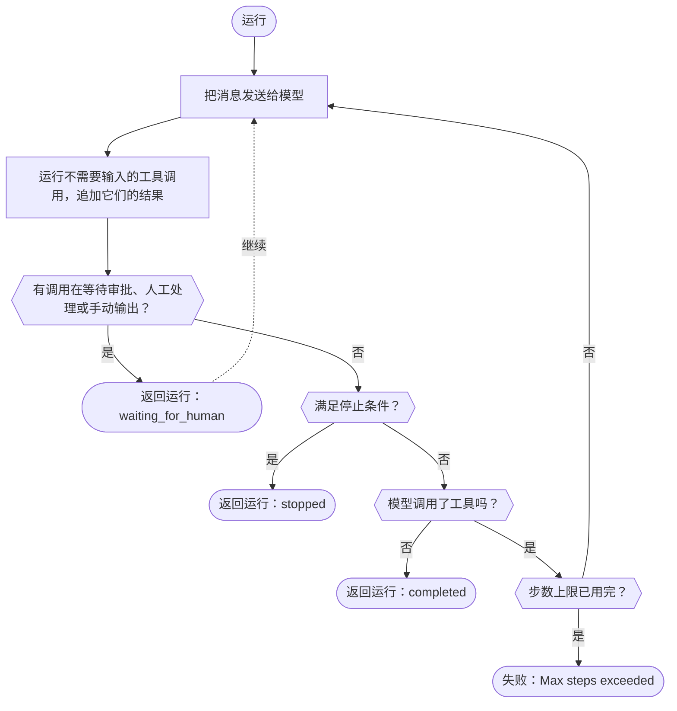

定义一个工具，创建一个智能体，然后用网关客户端运行它。模型调用你的工具，SDK 运行工具并把结果发回；当模型不调用工具直接回答、暂停等待人工处理或满足某个[停止条件](./stop-conditions)时，运行就会返回。如果运行先达到步数上限，SDK 会抛出错误；只有 Rust 会以 `stopped` 状态返回运行。Phaseo 不托管智能体，也不保存它的运行；这些由你的应用负责。

## 构建第一个智能体

<CodeGroup>

```typescript TypeScript
import {
  createAgent,
  createGatewayAgentClient,
  defineTool,
} from "@phaseo/agent-sdk";

const lookupDocs = defineTool({
  id: "lookup-docs",
  description: "Look up an internal docs page by slug.",
  parameters: {
    type: "object",
    properties: {
      slug: { type: "string" },
    },
    required: ["slug"],
    additionalProperties: false,
  },
  async execute(input: { slug: string }) {
    return {
      slug: input.slug,
      url: `https://phaseo.app/docs/v1/${input.slug}`,
    };
  },
});

const agent = createAgent({
  id: "support-docs-agent",
  model: "openai/gpt-6-astra",
  instructions: "Use tools when helpful and finish with a concise answer.",
  tools: [lookupDocs],
});

const result = await agent.run({
  input: "Find the docs page for presets and explain when to use them.",
  client: createGatewayAgentClient({
    clientOptions: {
      apiKey: process.env.PHASEO_API_KEY!,
    },
  }),
});

console.log(result.output);
```

```python Python
import os
from phaseo_agent import AgentTool, create_agent, create_gateway_agent_client, define_tool

lookup_docs = define_tool(AgentTool(
    id="lookup-docs",
    description="Look up an internal docs page by slug.",
    parameters={
        "type": "object",
        "properties": {"slug": {"type": "string"}},
        "required": ["slug"],
        "additionalProperties": False,
    },
    execute=lambda tool_input, runtime: {
        "slug": tool_input["slug"],
        "url": f"https://phaseo.app/docs/v1/{tool_input['slug']}",
    },
))

agent = create_agent({
    "id": "support-docs-agent",
    "model": "openai/gpt-6-astra",
    "instructions": "Use tools when helpful and finish with a concise answer.",
    "tools": [lookup_docs],
})

result = agent.run(
    input="Find the docs page for presets and explain when to use them.",
    client=create_gateway_agent_client(client_options={"api_key": os.environ["PHASEO_API_KEY"]}),
)

print(result.output)
```

```go Go
package main

import (
  "context"
  "fmt"

  phaseoagent "github.com/phaseoteam/Phaseo/packages/sdk/agent-sdk-go"
)

func main() {
  client, err := phaseoagent.CreateGatewayAgentClient(phaseoagent.GatewayAgentClientOptions{})
  if err != nil {
    panic(err) // 必须设置 PHASEO_API_KEY
  }

  lookup := phaseoagent.DefineTool(phaseoagent.Tool{
    ID:          "lookup_docs",
    Description: "Look up a Phaseo documentation topic",
    Parameters: map[string]any{
      "type":       "object",
      "properties": map[string]any{"topic": map[string]any{"type": "string"}},
      "required":   []string{"topic"},
    },
    Execute: func(input any, runtime phaseoagent.RuntimeContext) (any, error) {
      args, _ := input.(map[string]any)
      return map[string]any{"topic": args["topic"], "found": true}, nil
    },
  })

  agent := phaseoagent.CreateAgent(phaseoagent.AgentDefinition{
    ID:           "docs-agent",
    Model:        "openai/gpt-6-astra",
    Instructions: "Use tools when helpful and finish with a concise answer.",
    Tools:        []phaseoagent.Tool{lookup},
    MaxSteps:     6,
  })

  result, err := agent.Run(context.Background(), phaseoagent.RunOptions{
    Input:  "Explain when to use routing presets.",
    Client: client,
  })
  if err != nil {
    panic(err)
  }

  fmt.Println(result.Output)
  fmt.Println(result.Run.Status, result.Usage.TotalTokens)
}
```

```csharp C#
using System.Text.Json;
using PhaseoAgentSdk;

var lookup = AgentSdk.DefineTool(new Tool(
    "lookup_docs",
    async (input, runtime) =>
    {
        var topic = ((JsonElement)input!).GetProperty("topic").GetString();
        return new { topic, found = true };
    },
    "Look up a Phaseo documentation topic",
    new Dictionary<string, object?>
    {
        ["type"] = "object",
        ["properties"] = new Dictionary<string, object?> { ["topic"] = new { type = "string" } },
        ["required"] = new[] { "topic" },
    }));

var agent = AgentSdk.CreateAgent(new AgentDefinition
{
    Id = "docs-agent",
    Model = "openai/gpt-6-astra",
    Instructions = "Use tools when helpful and finish with a concise answer.",
    Tools = new[] { lookup },
    MaxSteps = 6,
});

var result = await agent.Run(new RunOptions
{
    Input = "Explain when to use routing presets.",
    Client = AgentSdk.CreateGatewayAgentClient(), // 缺少 PHASEO_API_KEY 时抛出异常
});

Console.WriteLine(result.Output);
Console.WriteLine($"{result.Run.Status} {result.Usage.TotalTokens}");
```

```php PHP
<?php
require "vendor/autoload.php";

use Phaseo\AgentSdk\AgentDefinition;
use Phaseo\AgentSdk\AgentSdk;
use Phaseo\AgentSdk\Tool;

$lookup = AgentSdk::defineTool(new Tool(
    id: "lookup_docs",
    execute: fn (array $input, $runtime) => ["topic" => $input["topic"], "found" => true],
    description: "Look up a Phaseo documentation topic",
    parameters: [
        "type" => "object",
        "properties" => ["topic" => ["type" => "string"]],
        "required" => ["topic"],
    ],
));

$agent = AgentSdk::createAgent(new AgentDefinition(
    id: "docs-agent",
    model: "openai/gpt-6-astra",
    instructions: "Use tools when helpful and finish with a concise answer.",
    tools: [$lookup],
    maxSteps: 6,
));

$result = $agent->run(
    input: "Explain when to use routing presets.",
    client: AgentSdk::createGatewayAgentClient() // 缺少 PHASEO_API_KEY 时抛出异常
);

echo $result->output . PHP_EOL;
echo $result->run->status . " " . $result->usage["total_tokens"] . PHP_EOL;
```

```ruby Ruby
require "phaseo_agent_sdk"

lookup = PhaseoAgentSdk.define_tool(
  PhaseoAgentSdk::Tool.new(
    id: "lookup_docs",
    description: "Look up a Phaseo documentation topic",
    parameters: {
      type: "object",
      properties: { topic: { type: "string" } },
      required: ["topic"]
    },
    execute: ->(input, runtime) { { topic: input["topic"], found: true } }
  )
)

agent = PhaseoAgentSdk.create_agent(
  id: "docs-agent",
  model: "openai/gpt-6-astra",
  instructions: "Use tools when helpful and finish with a concise answer.",
  tools: [lookup],
  max_steps: 6
)

result = agent.run(
  input: "Explain when to use routing presets.",
  client: PhaseoAgentSdk.create_gateway_agent_client # 缺少 PHASEO_API_KEY 时抛出异常
)

puts result.output
puts "#{result.run.status} #{result.usage[:total_tokens]}"
```

```java Java
import app.phaseo.agent.AgentSdk;
import java.time.Duration;
import java.util.List;
import java.util.Map;

var lookup = AgentSdk.defineTool(new AgentSdk.Tool(
    "lookup_docs",
    (input, context) -> Map.of("topic", ((Map<?, ?>) input).get("topic"), "found", true),
    "Look up a Phaseo documentation topic",
    Map.of(
        "type", "object",
        "properties", Map.of("topic", Map.of("type", "string")),
        "required", List.of("topic")),
    Duration.ofSeconds(10)
));

var agent = AgentSdk.createAgent(new AgentSdk.AgentDefinition(
    "docs-agent",                       // id
    "openai/gpt-6-astra",               // model
    null,                               // preset
    "Use tools when helpful and finish with a concise answer.", // instructions
    List.of(lookup),                    // tools
    6,                                  // maxSteps
    null, null, null, null              // parseOutput, humanReview, modelRetry, toolExecution
));

var result = agent.run(new AgentSdk.RunOptions(
    "Explain when to use routing presets.",  // input
    AgentSdk.createGatewayAgentClient(),     // 缺少 PHASEO_API_KEY 时抛出异常
    null, null, null, null, null, null, null, null
));

System.out.println(result.output());
System.out.println(result.run().status() + " " + result.usage().totalTokens());
```

```rust Rust
use phaseo_agent::{
    create_agent, create_gateway_agent_client, define_tool, AgentDefinition,
    RunOptions, Tool,
};
use serde_json::json;

fn main() -> Result<(), Box<dyn std::error::Error>> {
    let lookup = define_tool(Tool::new(
        "lookup_docs",
        "Look up a Phaseo documentation topic",
        json!({
            "type": "object",
            "properties": {
                "topic": { "type": "string" }
            },
            "required": ["topic"]
        }),
        |input, context| {
            Ok(json!({
                "topic": input["topic"],
                "run_id": context.run_id,
                "found": true
            }))
        },
    ));

    let agent = create_agent(
        AgentDefinition::new("docs-agent", "openai/gpt-6-astra")
            .instructions("Use lookup_docs when helpful. Answer concisely.")
            .max_steps(6)
            .tool(lookup),
    );

    let mut client = create_gateway_agent_client("openai/gpt-6-astra")?;
    let result = agent.run(
        &mut client,
        RunOptions::new("Explain when to use routing presets."),
    )?;

    println!("{}", result.output);
    println!("steps: {}", result.run.step_count);
    println!("tokens: {}", result.usage.total_tokens);
    Ok(())
}
```

</CodeGroup>

工具的 ID 就是模型看到的函数名，它的参数是模型要填写的 JSON Schema。参数会以各语言的原生形式传给你的代码：

| 语言 | 工具接收的类型 | 说明 |
| --- | --- | --- |
| TypeScript | 带类型的对象 | `execute(input, context)` |
| Python | `dict` | `execute(tool_input, runtime)` |
| Go | `any`（解码后的 JSON，通常是 `map[string]any`） | `Execute(input, runtime) (any, error)` |
| C# | `JsonElement` | `Execute(input, runtime)`，会被 await |
| PHP | 关联数组 | `execute(array $input, $runtime)` |
| Ruby | 键为字符串的 Hash | 用 `PhaseoAgentSdk::Tool.new` 构建工具；`define_tool` 原样返回你传入的内容，所以普通 Hash 无法使用 |
| Java | `Map` | record 按位置传参；没有设置的项传 `null` |
| Rust | `serde_json::Value` | 闭包在本地运行；`RuntimeContext` 包含运行 ID、智能体 ID、步骤索引、应用上下文和工具调用 |

如果智能体、运行和客户端都没有设置模型或预设，网关客户端会发送 `phaseo/free`。Rust 的 `create_gateway_agent_client` 把模型作为参数接收。

## 一次运行如何进行



每一步都会在返回的运行结果中创建检查点。要跨请求或重启恢复运行，把该结果保存到你自己的存储中，再传给继续方法，或者为智能体提供一个状态访问器；参见[状态与审批](./state-and-approval)。步数上限以及用完后的行为因语言而异：

<Tabs>
<Tab title="TypeScript">

除非你设置了 `maxSteps`，每次 `run()` 或 `continueRun()` 调用最多执行 12 步；超过后会抛出 `Max steps exceeded`。使用[停止条件](./stop-conditions)可以干净地结束运行。

</Tab>
<Tab title="Python">

除非你设置了 `max_steps`，一次运行最多执行 12 步；超过后会抛出 `RuntimeError`。停止条件只在模型没有发出工具调用的步骤上检查，所以顺序与图中不同：工具循环会一直运行，直到暂停、回答或用完 `max_steps`。

</Tab>
<Tab title="Go">

需要超过 `MaxSteps` 个模型轮次（默认 8）的运行会以 `Max steps exceeded (N)` 失败。

</Tab>
<Tab title="C#">

需要超过 `MaxSteps` 个模型轮次（默认 12）的运行会抛出 `InvalidOperationException("Max steps exceeded (N)")`。

</Tab>
<Tab title="PHP">

需要超过 `maxSteps` 个模型轮次（默认 12）的运行会抛出 `Max steps exceeded (N)`。

</Tab>
<Tab title="Ruby">

需要超过 `max_steps` 个模型轮次（默认 12）的运行会抛出 `Max steps exceeded (N)`。

</Tab>
<Tab title="Java">

需要超过 `maxSteps` 个模型轮次（默认 12）的运行会抛出 `Max steps exceeded (N)`。

</Tab>
<Tab title="Rust">

除非你调用 `.max_steps(n)` 或设置 `RunOptions.max_steps`，一次运行最多执行 8 个模型轮次。达到上限不会失败：运行返回时 `run.status` 为 `stopped`，`run.stop_reason` 为 `max_steps:<limit>`。运行是同步的，本地工具一次执行一个，所以当运行不应阻塞请求处理函数时，请使用工作线程或任务边界。

</Tab>
</Tabs>

## 读取运行结果

每次运行都返回相同的几部分。字段名遵循各语言的大小写习惯（`output`、`Output`、`output()`）：

| 部分 | 内容 |
| --- | --- |
| `run` | 状态、ID、实际使用的模型、步数上限、上下文、暂停状态和停止原因 |
| `steps` | 每个模型轮次一条记录：请求 ID、提供商、模型、结束原因、警告、工具调用和用量 |
| `messages` | 完整的对话，包括工具结果 |
| `output` | 最终输出 |
| `usage` | 输入、输出、缓存和总 token 数，以及费用 |

Rust 的 `usage.cost` 只来自响应中数值型的 `meta.cost` 或 `cost`；它不会映射 `cost_nanos` 或 `cost_cents`。在 Rust 中统计花费时，请使用 Gateway 响应或生成记录。

## 找到合适的功能

| 要… | 页面 |
| --- | --- |
| 为模型提供本地工具、手动工具或会报告进度的工具 | [工具](./tools) |
| 暂停以等待审批或人工处理，然后恢复 | [状态与审批](./state-and-approval) |
| 实时显示文本和工具活动 | [流式传输](./streaming) |
| 渲染由消息、推理和工具调用组成的时间线 | [条目](./items) |
| 限制步数、token、费用或时间 | [停止条件](./stop-conditions) |
| 在轮次之间更换模型或工具 | [动态轮次](./dynamic-turns) |
| 获取带类型的输出、重试模型调用、使用预设 | [输出与重试](./run-controls) |
| 记录或审计每一步 | [生命周期钩子](./lifecycle-hooks) |
| 记录一次运行的用量、费用和请求 ID | [可观测性](./observability) |
| 处理网关、schema 和步数上限错误 | [事件与错误](./events-and-errors) |
| 在本地检查运行 | [DevTools](./devtools) |

每个导出项都列在 [API 参考](./api-reference)中，完整的智能体见[示例](./examples)。
